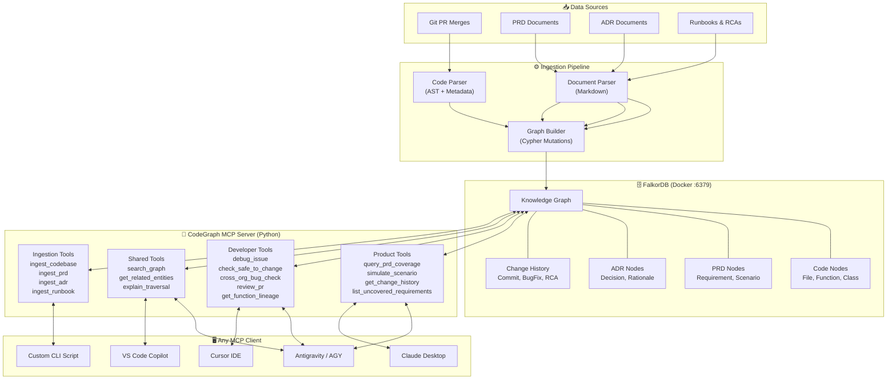
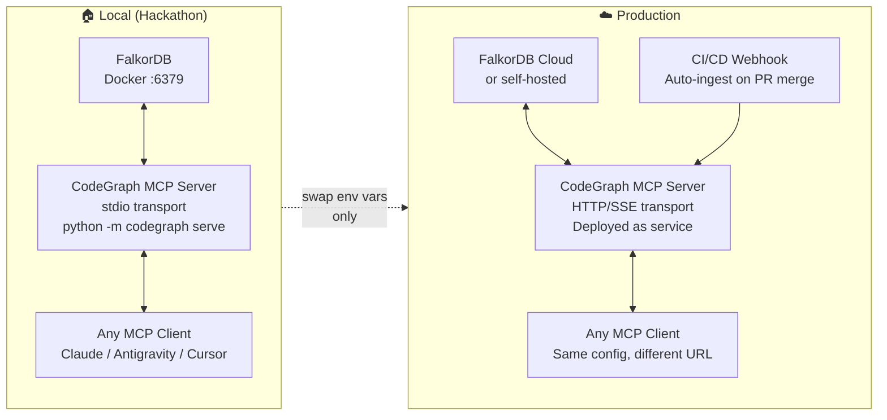
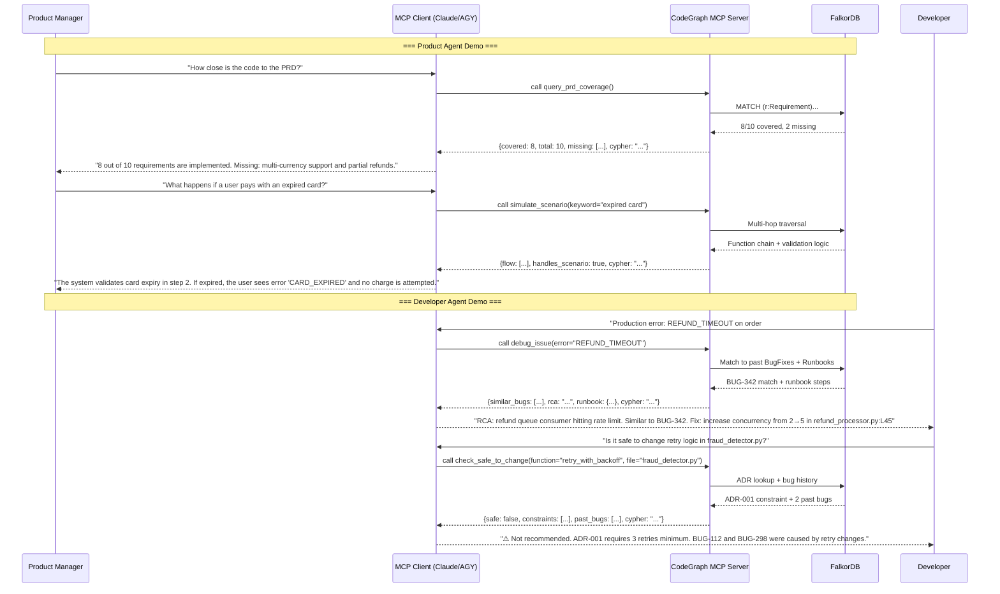

# 🧠 CodeGraph Agents — Hackathon Implementation Plan

> **Track 01: Agents That Act on Connected Data**
> Multi-hop reasoning · Graph queries as agent tools · Tool selection through MCP · Actions based on graph data · Explainable results


---

## 1. Problem Statement (Two Pain Points)

| # | Pain Point | Who Suffers |
|---|-----------|-------------|
| 1 | **UAT Bottleneck** — Product managers can't verify if code matches the PRD without going through developers. Testing edge-case scenarios requires dev cycles, creating a back-and-forth loop that delays deployment. | Product Managers |
| 2 | **Knowledge Loss** — New developers don't know *why* existing code was written (PRD requirement vs. architectural decision vs. bug fix). Overriding code without this context introduces regressions, bugs, or financial loss. No lineage of changes. | Developers |

---

## 2. Solution: CodeGraph Agents

A **FalkorDB-backed knowledge graph** that connects three core entities — **Code**, **PRD**, and **ADR** — with full change history. Two persona-specific agents query the graph:

| Agent | Audience | Communication Style | Key Capabilities |
|-------|----------|---------------------|------------------|
| **Product Agent** | Product Managers | Plain English, no code snippets | PRD compliance check, scenario simulation, test coverage summary, change history |
| **Developer Agent** | Engineers | Technical, includes code/logs | Production debugging with RCA, safe-to-change analysis, cross-org bug pattern matching, PR review |

---

## 3. Architecture

> [!IMPORTANT]
> **No custom UI.** The MCP server *is* the product. Any MCP-compatible client becomes the UI — Claude Desktop, Antigravity, Cursor, VS Code Copilot, or a simple CLI script. Zero frontend code to maintain.



### How It Works



**The only difference between local and production is environment variables.** The MCP server code, tools, and graph schema are identical.

| Aspect | Local (Hackathon) | Production |
|--------|------------------|------------|
| FalkorDB | Docker `localhost:6379` | FalkorDB Cloud or self-hosted |
| MCP transport | `stdio` (launched by client) | `http` / `sse` (deployed as service) |
| Data ingestion | `python seed.py` (one-shot demo data) | CI/CD webhook on PR merge |
| LLM | Client's LLM (Claude/Antigravity/Cursor) | Same — LLM is always in the client |
| Config change | None | Set `FALKORDB_HOST`, `FALKORDB_PORT`, `MCP_TRANSPORT=http` |

### MCP Server Configuration

#### Local (Hackathon Demo) — stdio transport

Drop this into your MCP client config (Claude Desktop, Antigravity, Cursor — all use the same format):

```json
{
  "mcpServers": {
    "codegraph": {
      "command": "python",
      "args": ["-m", "codegraph", "serve"],
      "env": {
        "FALKORDB_HOST": "localhost",
        "FALKORDB_PORT": "6379"
      }
    }
  }
}
```

#### Production — HTTP transport

Deploy the MCP server as a service, then point clients to its URL:

```json
{
  "mcpServers": {
    "codegraph": {
      "url": "https://codegraph.yourcompany.com/mcp",
      "headers": {
        "Authorization": "Bearer ${CODEGRAPH_API_KEY}"
      }
    }
  }
}
```

The server itself switches transport based on a single env var:

```python
# codegraph/mcp_server.py — transport selection
transport = os.environ.get("MCP_TRANSPORT", "stdio")  # "stdio" | "http"
```

> [!TIP]
> **For the hackathon demo**: Use `stdio` transport. The MCP client launches the server process automatically when you chat. Zero setup beyond the JSON config above.

### Graph Schema

```mermaid
erDiagram
    PRD ||--o{ Requirement : contains
    Requirement ||--o{ Scenario : has
    Requirement ||--o{ Function : "implemented_by"
    ADR ||--o{ Decision : documents
    Decision ||--o{ Function : "affects"
    Decision ||--o{ Requirement : "relates_to"
    File ||--o{ Function : contains
    File ||--o{ Class : contains
    Class ||--o{ Function : contains
    Function ||--o{ Function : calls
    Function ||--o{ ChangeRecord : "changed_by"
    ChangeRecord ||--o{ BugFix : "fixes"
    BugFix ||--o{ RCA : has
    Runbook ||--o{ Function : "documents_debugging_for"
    Runbook ||--o{ BugFix : "created_from"
```

### Key Node Types & Properties

| Node | Properties |
|------|-----------|
| `PRD` | `id`, `title`, `version`, `created_at`, `status` |
| `Requirement` | `id`, `prd_id`, `description`, `priority`, `status` |
| `Scenario` | `id`, `description`, `expected_behavior`, `covered_by_code` (bool) |
| `ADR` | `id`, `title`, `status` (accepted/superseded), `date`, `context`, `decision`, `consequences` |
| `File` | `path`, `language`, `last_modified` |
| `Function` | `name`, `signature`, `file_path`, `line_start`, `line_end`, `description` |
| `Class` | `name`, `file_path`, `line_start`, `line_end` |
| `ChangeRecord` | `commit_hash`, `author`, `date`, `message`, `reason` (prd/adr/bugfix/refactor) |
| `BugFix` | `id`, `ticket`, `description`, `rca`, `fix_summary`, `date` |
| `Runbook` | `id`, `title`, `steps`, `related_service` |

### Key Relationship Types

| Relationship | From → To | Properties |
|-------------|-----------|------------|
| `IMPLEMENTS` | Requirement → Function | `coverage_pct`, `notes` |
| `HAS_SCENARIO` | Requirement → Scenario | — |
| `DECIDED_BY` | Function → ADR | `rationale` |
| `CHANGED_BY` | Function → ChangeRecord | `diff_summary` |
| `CALLS` | Function → Function | — |
| `CONTAINS` | File → Function/Class | — |
| `RELATES_TO` | ADR → Requirement | `impact` |
| `FIXED_BY` | BugFix → ChangeRecord | — |

---

## 4. Tech Stack (All Local)

| Component | Technology | Why |
|-----------|-----------|-----|
| Graph DB | **FalkorDB** (Docker) | Graph RAG, OpenCypher, sub-millisecond queries |
| MCP Server | **`mcp` Python SDK** (`mcp[cli]`) | Build the MCP server that exposes all tools to any client |
| LLM | *None on server side* | LLM lives in the client (Claude/Antigravity/Cursor). We just serve tools. |
| Code Parsing | **`ast`** (Python stdlib) | Parse Python files into function/class nodes. Zero deps. |
| Graph Client | **`falkordb`** (Python) | Direct Cypher queries from MCP server to FalkorDB |

> [!TIP]
> We do NOT need LangGraph, LangChain, or any agent framework. The MCP server exposes tools directly — the LLM agent lives in the client and does the reasoning. We just provide the tools. Laziest, most portable architecture. Fewest deps.

---

## 5. Project Structure

```
GraphHack/
├── docker-compose.yml              # FalkorDB
├── pyproject.toml                   # Project config + deps (falkordb, mcp[cli])
├── README.md
│
├── codegraph/                       # Python package
│   ├── __init__.py
│   ├── __main__.py                  # CLI: python -m codegraph serve | ingest
│   ├── mcp_server.py               # MCP server — registers all tools, stdio/http
│   ├── db.py                        # FalkorDB connection + Cypher helpers
│   ├── queries.py                   # Reusable Cypher query templates
│   │
│   ├── ingest/                      # Ingestion pipeline
│   │   ├── __init__.py
│   │   ├── code_parser.py           # Python AST → graph nodes
│   │   ├── prd_parser.py            # PRD markdown → Requirement/Scenario nodes
│   │   ├── adr_parser.py            # ADR markdown → Decision nodes
│   │   └── change_tracker.py        # Git log → ChangeRecord nodes
│   │
│   └── tools/                       # MCP tool implementations
│       ├── __init__.py
│       ├── product_tools.py         # PRD coverage, scenario sim, change history
│       ├── developer_tools.py       # Debug, safe-to-change, PR review, lineage
│       ├── shared_tools.py          # search_graph, get_related_entities
│       └── ingest_tools.py          # Ingest code/PRD/ADR/runbook via MCP
│
├── prompts/                         # Ready-to-paste system prompts for clients
│   ├── product-persona.md           # "You are a product advisor. NEVER show code..."
│   └── developer-persona.md         # "You are a senior engineering assistant..."
│
├── demo_data/                       # Example project for hackathon demo
│   ├── code/                        # Sample payment service codebase
│   │   ├── payment_service.py
│   │   ├── fraud_detector.py
│   │   ├── refund_processor.py
│   │   └── notification_service.py
│   ├── prd/
│   │   └── payment-gateway-prd.md
│   ├── adr/
│   │   ├── 001-fraud-detection-engine.md
│   │   └── 002-async-refund-processing.md
│   └── runbooks/
│       └── payment-failure-debug.md
│
└── seed.py                          # One-shot: ingest all demo_data into graph
```

---

## 6. MCP Tools — Complete Inventory

> [!IMPORTANT]
> Each tool maps to one or more Cypher queries. The tool returns structured data + the Cypher query used (for explainability). The LLM client formats the response based on its persona prompt.

### Product Tools

| Tool | Description | Cypher Pattern | Demo Scenario |
|------|------------|----------------|---------------|
| `query_prd_coverage` | Show which PRD requirements have code, which don't | `MATCH (r:Requirement) OPTIONAL MATCH (r)-[:IMPLEMENTED_BY]->(f:Function) RETURN r, f` | "How complete is the code vs the PRD?" |
| `simulate_scenario` | Trace what happens when a scenario occurs, following function call chains | `MATCH (s:Scenario)<-[:HAS_SCENARIO]-(r)-[:IMPLEMENTED_BY]->(f)-[:CALLS*1..5]->(g) WHERE s.description CONTAINS $keyword RETURN ...` | "What happens if a user pays with an expired card?" |
| `get_change_history` | Timeline of changes with reasons (PRD/bug/ADR) | `MATCH (cr:ChangeRecord)-[:CHANGED]->(f:Function) WHERE cr.date >= $from RETURN cr ORDER BY cr.date` | "What changed between v1.0 and v1.1?" |
| `list_uncovered_requirements` | Requirements with no linked code | `MATCH (r:Requirement) WHERE NOT (r)-[:IMPLEMENTED_BY]->() RETURN r` | "What's missing from the implementation?" |

### Developer Tools

| Tool | Description | Cypher Pattern | Demo Scenario |
|------|------------|----------------|---------------|
| `debug_issue` | Match error to past BugFixes + Runbook steps | `MATCH (b:BugFix)-[:FIXED_BY]->(cr)-[:CHANGED]->(f) WHERE b.description CONTAINS $error OPTIONAL MATCH (rb:Runbook)-[:DOCUMENTS]->(f) RETURN ...` | "Debug REFUND_TIMEOUT error" |
| `check_safe_to_change` | Check ADR constraints + past bug history for a function | `MATCH (f:Function {name: $fn}) OPTIONAL MATCH (f)<-[:AFFECTS]-(d:Decision)<-[:DOCUMENTS]-(a:ADR) OPTIONAL MATCH (b:BugFix)-[:FIXED_BY]->(cr)-[:CHANGED]->(f) RETURN ...` | "Is it safe to change retry logic?" |
| `get_function_lineage` | Full history of why a function exists and every change | `MATCH (f:Function {name: $fn})<-[:CHANGED]-(cr:ChangeRecord) RETURN cr ORDER BY cr.date` | "Why does this function exist?" |
| `review_pr_diff` | Check if changed functions have known issues/constraints | Multi-query: for each function in diff, run `check_safe_to_change` | "Review this PR" |
| `cross_org_bug_check` | Find similar bugs across codebases by pattern | `MATCH (b:BugFix) WHERE b.description CONTAINS $pattern OR b.rca CONTAINS $pattern RETURN b` | "Have we seen this before?" |

### Shared Tools

| Tool | Description | Cypher Pattern |
|------|------------|----------------|
| `search_graph` | Free-text search across all entity types | `MATCH (n) WHERE any(prop IN keys(n) WHERE toString(n[prop]) CONTAINS $query) RETURN n LIMIT 20` |
| `get_related_entities` | Given any node, find all connected nodes up to N hops | `MATCH path = (n {id: $id})-[*1..$hops]-(related) RETURN path` |
| `explain_traversal` | Return the Cypher query + path for any previous tool call | Returns the last query's plan + traversal path |

### Ingestion Tools (for live updates — production path)

| Tool | Description |
|------|------------|
| `ingest_codebase` | Parse Python files from a directory into graph nodes |
| `ingest_prd` | Parse a PRD markdown file into Requirement/Scenario nodes |
| `ingest_adr` | Parse an ADR markdown file into ADR/Decision nodes |
| `ingest_runbook` | Parse a runbook into Runbook nodes linked to functions |
| `record_bugfix` | Add a BugFix + RCA node and link to affected functions (with approval flag) |

---

## 7. Demo Project: **PayFlow** — Payment Gateway Service

> [!IMPORTANT]
> This is the example project used during the hackathon demo. The demo data is pre-seeded into FalkorDB. Each scenario below works end-to-end with the MCP tools above.

### Demo Scenario Flow



---

## 8. Implementation Phases

### Phase 1 — Foundation & Demo Data (2 hours)
- [ ] `docker-compose.yml` — FalkorDB with volume mount for persistence
- [ ] `pyproject.toml` — deps: `falkordb`, `mcp[cli]`
- [ ] `codegraph/db.py` — FalkorDB connection helper (reads `FALKORDB_HOST`/`PORT` from env)
- [ ] `codegraph/queries.py` — Cypher templates for schema creation + all tool queries
- [ ] Create demo codebase: `demo_data/code/*.py` (4 Python files with realistic payment logic)
- [ ] Write demo PRD: `demo_data/prd/payment-gateway-prd.md` (10 requirements, scenarios)
- [ ] Write demo ADRs: `demo_data/adr/001-fraud-detection-engine.md`, `002-async-refund-processing.md`
- [ ] Write demo runbook: `demo_data/runbooks/payment-failure-debug.md`

### Phase 2 — Ingestion Pipeline (2 hours)
- [ ] `codegraph/ingest/code_parser.py` — Python `ast` → File/Class/Function nodes + CALLS edges
- [ ] `codegraph/ingest/prd_parser.py` — Structured markdown → PRD/Requirement/Scenario nodes
- [ ] `codegraph/ingest/adr_parser.py` — ADR markdown → ADR/Decision nodes
- [ ] `codegraph/ingest/change_tracker.py` — Simulated ChangeRecord + BugFix + RCA nodes
- [ ] `seed.py` — Run all parsers + create cross-entity relationships
- [ ] Verify graph in FalkorDB browser at `http://localhost:3000`

### Phase 3 — MCP Server & Tools (3 hours)
- [ ] `codegraph/mcp_server.py` — MCP server with `mcp` Python SDK, stdio/http transport
- [ ] Product tools: `query_prd_coverage`, `simulate_scenario`, `get_change_history`, `list_uncovered_requirements`
- [ ] Developer tools: `debug_issue`, `check_safe_to_change`, `get_function_lineage`, `review_pr_diff`, `cross_org_bug_check`
- [ ] Shared tools: `search_graph`, `get_related_entities`, `explain_traversal`
- [ ] Ingestion tools: `ingest_codebase`, `ingest_prd`, `ingest_adr`, `ingest_runbook`, `record_bugfix`
- [ ] Every tool returns `{result: ..., cypher_query: "...", traversal_path: [...]}` for explainability

### Phase 4 — Persona Prompts & Integration (1 hour)
- [ ] `prompts/product-persona.md` — System prompt: no code, plain English, business language
- [ ] `prompts/developer-persona.md` — System prompt: technical, code blocks, file references
- [ ] `codegraph/__main__.py` — CLI: `python -m codegraph serve` / `python -m codegraph ingest <path>`
- [ ] Test all 6 demo scenarios end-to-end with Claude Desktop or Antigravity

### Phase 5 — Polish & Demo Prep (1 hour)
- [ ] README.md with setup instructions, MCP config JSON, and demo script
- [ ] Ensure every tool gracefully handles missing data ("not implemented yet")
- [ ] `explain_traversal` shows the graph path visually in text form

---

## 9. Track Requirements Mapping

| Track Requirement | How We Address It |
|-------------------|-------------------|
| **Multi-hop reasoning** | `simulate_scenario` traverses: `Requirement → Function → CALLS → Function → ...` up to 5 hops. `get_related_entities` does N-hop expansion. |
| **Graph queries as agent tools** | All 15 MCP tools execute Cypher queries. Each tool returns the query used. |
| **Tool selection through MCP** | Our custom MCP server exposes 15 tools. The LLM client selects which to call based on the user's question. |
| **Actions based on graph data** | `check_safe_to_change` → safe/unsafe recommendation. `debug_issue` → RCA + fix. `query_prd_coverage` → missing requirements list. |
| **Explainable results** | Every tool returns `cypher_query` and `traversal_path`. `explain_traversal` shows the full reasoning chain. |

---

## 10. Key Demo Scenarios

### Product Agent (paste `prompts/product-persona.md` as system prompt)
1. **"How complete is the code vs. the PRD?"** → `query_prd_coverage` → 8/10, lists missing
2. **"What happens if a user pays with an expired card?"** → `simulate_scenario` → multi-hop, plain English
3. **"What changed between v1.0 and v1.1?"** → `get_change_history` → timeline with reasons
4. **"What scenarios aren't covered yet?"** → `list_uncovered_requirements` → gap analysis

### Developer Agent (paste `prompts/developer-persona.md` as system prompt)
5. **"Debug production error: REFUND_TIMEOUT"** → `debug_issue` → RCA, past match, runbook
6. **"Is it safe to change retry logic in fraud_detector.py?"** → `check_safe_to_change` → ADR + bugs
7. **"Why does process_refund exist and what changed?"** → `get_function_lineage` → full history
8. **"Find similar bugs across codebases"** → `cross_org_bug_check` → pattern match

---

## 11. Quick Start

```bash
# 1. Start FalkorDB
docker compose up -d

# 2. Install
pip install -e .

# 3. Seed demo data
python seed.py

# 4. Verify graph (browser)
open http://localhost:3000

# 5. Add MCP config to your client (Claude Desktop / Antigravity / Cursor)
#    Copy the JSON from section 3 into your client's MCP config file.
#    Then just start chatting — the MCP server launches automatically.
```

---

## 12. Production Upgrade Path

When moving from hackathon to production, change **only environment variables**:

```bash
# Hackathon (local)
FALKORDB_HOST=localhost
FALKORDB_PORT=6379
MCP_TRANSPORT=stdio

# Production
FALKORDB_HOST=your-falkordb-cloud.example.com
FALKORDB_PORT=6379
FALKORDB_PASSWORD=your-password
MCP_TRANSPORT=http
MCP_HTTP_PORT=8080
MCP_API_KEY=your-api-key
```

Additional production features (not in hackathon scope):
- CI/CD webhook → calls `ingest_codebase` on PR merge
- `record_bugfix` has approval workflow (flag in graph, reviewed before linking)
- Multi-org graph isolation via FalkorDB graph namespacing
- Auth middleware on HTTP transport

> [!NOTE]
> The MCP server code is identical between local and production. The `mcp` Python SDK handles both `stdio` and `http` transports natively. No code changes needed — just env vars.

