# 🧠 StrataGraph: Connected Knowledge Graph for Code, PRD, and ADR

> A connected graph intelligence platform unifying Source Code (AST), Product Requirements (PRD), Architecture Decisions (ADR), Operations, and Agile Delivery.

---

## 💡 The Problem

1. **The UAT & PRD Verification Bottleneck:**  
   Product Managers create PRDs and hand them off to engineering. When testing features for UAT, product teams cannot verify whether complex edge-case scenarios are guarded in the code without engineering cycles. Every verification requires back-and-forth communication, slowing release velocity.
2. **Knowledge Loss & Blind Overrides:**  
   When developers join a team, they don't know *why* existing code was written—is a specific check due to a PRD requirement, an architectural constraint (ADR), or a past regression fix? Overriding code without this context introduces severe bugs, SLA violations, or financial loss. There is no unified quality lineage.

---

## 🚀 The Solution: StrataGraph

StrataGraph connects **Source Code (AST)**, **Product Requirements (PRD)**, **Architecture Decisions (ADR)**, **Operations (Runbooks, BugFixes, RCAs)**, and **Program Flow (Agile Epics, Features, Stories)** into a unified property graph backed by **FalkorDB**.

### Dual-Access Architecture (Interactive MCP & Standalone Ingestion)
StrataGraph is designed with two distinct operational planes:
1. **Interactive Agent Plane (MCP Server):** Any MCP-compliant client (**Claude Desktop, Antigravity, Cursor, VS Code Copilot, or CLI**) connects over `stdio` or `streamable-http/sse` to converse with 4 specialized Agent Personas across 33 typed tools.
2. **Standalone Production Ingestion Plane (CLI & CI/CD):** An independent core subsystem (`codegraph/ingest/`) indexes arbitrary polyglot codebases (ASTs), enterprise documentation formats (Markdown, PDF, Confluence, Word, Jira), and git commit histories directly into FalkorDB without requiring an active LLM or MCP session.

```
=============================================================================================================
                                     STRATAGRAPH SYSTEM ARCHITECTURE
=============================================================================================================

 ┌─────────────────────────────────────────────────────────┐  ┌────────────────────────────────────────────┐
 │                  Interactive MCP Clients                │  │    Standalone Automation, CLI & CI/CD      │
 │     (Claude Desktop / Cursor / Antigravity / Copilot)   │  │ (python -m codegraph ingest / Git Hooks)   │
 └────────────────────────────┬────────────────────────────┘  └─────────────────────┬──────────────────────┘
                              │ JSON-RPC (stdio or HTTP/SSE)                        │ Direct CLI Ingestion
                              ▼                                                     ▼
 ┌─────────────────────────────────────────────────────────────────────────────────────────────────────────┐
 │                       🛡️ Agent Security Harness & Ingestion Guardrails (ADR-017)                         │
 │  • Pre-Execution IAM RBAC Gate (enforce_permission)     • Anti-DoS Payload Limit (10MB Cap)             │
 │  • Canonical Path Sandboxing (Path.resolve / LFI)       • Adversarial Prompt Injection Sanitizer        │
 │  • Sensitive Secret Shield (.env, id_rsa, keys)         • Staged Quarantine Gate (PENDING_APPROVAL)     │
 └────────────────────────────┬─────────────────────────────────────────────────────┬──────────────────────┘
                              │                                                     │
                              ▼                                                     ▼
 ┌─────────────────────────────────────────────────────────┐  ┌────────────────────────────────────────────┐
 │               StrataGraph MCP Server Layer              │  │        Standalone Ingestion Engine         │
 │                  (codegraph/mcp_server.py)              │  │           (codegraph/ingest/)              │
 │                                                         │  ├────────────────────────────────────────────┤
 │ 🏛️ Systems Architect Persona (architect_advisor)        │  │ • CodebaseParser (AST: Py, TS, Go, Java)   │
 │   • propose_architectural_change • list_iam_roles       │  │ • DocumentConverter (PDF, DOCX, HTML, TXT) │
 │   • approve_architectural_prop   • check_safe_to_change │  │ • PRDParser & ADRParser & ChangeTracker    │
 │   • check_iam_permission         • search_graph         │  │ • JiraParser (Epics, Features, Stories)    │
 │                                                         │  │ • GitCommitLogExtractor (git log lineage)  │
 │ 📋 Product Manager Persona (product_advisor)            │  │ • Heuristic Cross-Entity Auto-Linker       │
 │   • query_prd_coverage           • list_uncovered_req   │  └─────────────────────┬──────────────────────┘
 │   • simulate_scenario (NL)       • update_prd_features  │                        │
 │   • get_change_history           • approve_prd_update   │                        │
 │                                                         │                        │
 │ 💻 Software Engineer Persona (developer_assistant)      │                        │
 │   • debug_issue (RCA matching)   • review_pr_diff       │                        │
 │   • check_safe_to_change         • cross_org_bug_check  │                        │
 │   • get_function_lineage         • record_bugfix        │                        │
 │                                                         │                        │
 │ 📊 Program Manager (TPM) Persona (program_manager)      │                        │
 │   • query_program_delivery_status• get_lead_time_metrics│                        │
 │   • diagnose_delivery_bottlenecks• trace_delivery_chain │                        │
 │   • unlock_cross_team_cap        • create_epic/feat/st  │                        │
 │                                                         │                        │
 │ 🔍 Shared Exploration Tools                             │                        │
 │   • search_graph  • get_related_entities  • explain_path│                        │
 └────────────────────────────┬────────────────────────────┘                        │
                              │                                                     │
                              │               ┌─────────────────────────────────────┴──────────────────────┐
                              │               │   🔐 Cryptographic Human-in-the-Loop Approval Gateway      │
                              │               │   • Code Domain Owner (.github/CODEOWNERS) ➔ BugFix Gate   │
                              │               │   • PRD Owner (Project.prd_owner) ➔ Requirements Gate      │
                              │               │   • Architect Lead (Project.architect_owner) ➔ ADR Gate    │
                              │               │   Channels: 1-Click HTTP Link / CLI / MCP Approval Tools   │
                              │               └─────────────────────────────────────┬──────────────────────┘
                              │                                                     │
                              ▼                                                     ▼
 ┌─────────────────────────────────────────────────────────────────────────────────────────────────────────┐
 │                               🗄️ Dual-Engine Graph Persistence Layer                                     │
 │                                                                                                         │
 │   Primary: FalkorDB (SuiteSparse:GraphBLAS)           Fallback: LocalMemoryGraph (Zero-Dependency)      │
 │   • Matrix Multiplication (C = A · B) over semirings  • Deterministic In-Memory Property Graph Engine    │
 │   • 24 Single-Property Indexes (O(1) lookups)         • Multi-Hop BFS Neighborhood Traverser            │
 │   • Categorical String Interning (intern($val))       • Atomic State File (codegraph_local_store.json)  │
 │   • Parameterized Plan Caching ($params)              • 100% Offline Resilience (No Docker Required)    │
 └────────────────────────────────────────────────────┬────────────────────────────────────────────────────┘
                                                      │
                                                      ▼
 ┌─────────────────────────────────────────────────────────────────────────────────────────────────────────┐
 │                               🧠 5-Pillar Connected Knowledge Graph Data Model                           │
 │                                                                                                         │
 │                     ┌─────────────────────────── [ Root: Project ] ───────────────────────────┐         │
 │                     │   • codebase_owner       • prd_owner       • architect_owner            │         │
 │                     ▼                           ▼                           ▼                 │         │
 │    ┌───────────────────────────┐ ┌───────────────────────────┐ ┌───────────────────────────┐ │         │
 │    │     1. CodeBase Pillar    │ │       2. PRD Pillar       │ │       3. ADR Pillar       │ │         │
 │    │ CodeInput ➔ LogicFlow     │ │ PRDInput ➔ Requirement    │ │ ADRRequirement ➔ Architecture│         │
 │    │ ➔ Class ➔ Function        │ │ ➔ Guardrail ➔ PRDOutput   │ │ ➔ Decision ➔ ADRResult    │ │         │
 │    │ ➔ CodeLogic ➔ CodeOutput  │ │                           │ │ (Governing Invariants)    │ │         │
 │    └─────────────┬─────────────┘ └─────────────┬─────────────┘ └─────────────┬─────────────┘ │         │
 │                  │                             │                             │               │         │
 │                  ▼                             ▼                             ▼               │         │
 │    ┌───────────────────────────┐                 ┌───────────────────────────┐               │         │
 │    │    4. Operations Pillar   │                 │   5. Program Flow Pillar  │◄──────────────┘         │
 │    │ Issue (Incident/Bug)      │                 │ Epic ➔ AgileFeature       │                         │
 │    │ ➔ RCA (Root Cause)        │                 │ ➔ Story (Agile Task)      │                         │
 │    │ ➔ Fix ➔ OpResult          │                 │ ➔ Developer / Function    │                         │
 │    └─────────────┬─────────────┘                 └─────────────┬─────────────┘                         │
 │                  │                                             │                                       │
 │                  └───────────────────────┬─────────────────────┘                                       │
 │                                          ▼                                                             │
 │               ┌─────────────────────────────────────────────────────────────────────┐                  │
 │               │             Temporal Lineage Anchor: ChangeTimeline                 │                  │
 │               │      (Captures WHAT changed and WHY it changed across all pillars)  │                  │
 │               └─────────────────────────────────────────────────────────────────────┘                  │
 └─────────────────────────────────────────────────────────────────────────────────────────────────────────┘
```



```mermaid
flowchart TD
    subgraph Clients["🖥️ Clients & Automation Channels"]
        direction LR
        MCP_CLIENTS["Interactive MCP Clients\n(Claude Desktop / Cursor / Antigravity / Copilot)"]
        CLI_CICD["Standalone Automation & CI/CD\n(Click CLI / GitHub Actions / Webhooks)"]
    end

    subgraph Security["🛡️ Agent Security Harness & Ingestion Guardrails (ADR-017)"]
        IAM_GATE["IAM Pre-Execution RBAC Gate\n(enforce_permission)"]
        SANDBOX["Canonical Path Sandboxing\n(Path.resolve / LFI Protection)"]
        SECRETS["Sensitive Secret Shield\n(.env / id_rsa / Private Keys)"]
        ANTIDOS["Payload Anti-DoS Limits\n(10 MB Cap / Stat Inspection)"]
        SANITIZER["Adversarial Prompt Sanitizer\n(Injection & Script Scrubbing)"]
        QUARANTINE["Staged Quarantine Gate\n(PENDING_APPROVAL Isolation)"]
    end

    subgraph EntryLayers["⚙️ Execution & Interface Layer"]
        subgraph MCPServer["🔌 StrataGraph MCP Server (stdio / streamable-http)"]
            ARCH_TOOLS["🏛️ Systems Architect Persona\n• propose_architectural_change\n• approve_architectural_proposal\n• check_iam_permission\n• list_iam_roles\n• check_safe_to_change\n• search_graph"]
            PROD_TOOLS["📋 Product Manager Persona\n• query_prd_coverage\n• simulate_scenario\n• get_change_history\n• list_uncovered_requirements\n• update_prd_features_and_scenarios\n• approve_prd_update_via_email"]
            DEV_TOOLS["💻 Software Engineer Persona\n• debug_issue (RCA matching)\n• check_safe_to_change\n• get_function_lineage\n• review_pr_diff\n• cross_org_bug_check\n• record_bugfix"]
            PROG_TOOLS["📊 Program Manager (TPM) Persona\n• query_program_delivery_status\n• diagnose_delivery_bottlenecks\n• unlock_cross_team_capabilities\n• get_feature_lead_time_metrics\n• trace_requirement_to_delivery_chain\n• create_epic / feature / story"]
            SHARED_TOOLS["🔍 Shared Tools\n• search_graph\n• get_related_entities (N-hop BFS)\n• explain_traversal (ASCII path)"]
        end

        subgraph IngestPipeline["📥 Standalone Ingestion Engine (codegraph/ingest/)"]
            PARSER_CODE["CodebaseParser\n(Python AST, TS, Go, Java, Rust)"]
            CONV_DOC["DocumentConverter\n(MD, HTML, Confluence, Jira, PDF, Docx)"]
            PARSER_PRD_ADR["PRD & ADR & Runbook Parsers"]
            PARSER_JIRA["Jira Board Parser (Epics, Features, Stories)"]
            EXTR_GIT["Git Commit Log Extractor"]
            AUTOLINK["Cross-Entity Heuristic Auto-Linker"]
        end
    end

    subgraph Governance["🔐 Cryptographic Approval Gateway (Triple-Ownership)"]
        OWNER_CODE["Codebase Owner (.github/CODEOWNERS)\nBugFix & AST Mutation Signoff"]
        OWNER_PRD["PRD Owner (Project.prd_owner)\nRequirement & Scenario Signoff"]
        OWNER_ARCH["Architect Lead (Project.architect_owner)\nADR & Invariant Signoff"]
        APPROVE_CHANNELS["Approval Channels: 1-Click HTTP / CLI / MCP Tool"]
    end

    subgraph Engine["🗄️ Dual-Engine Database Layer (ADR-001, ADR-018)"]
        FALKOR["FalkorDB (Primary)\n• SuiteSparse:GraphBLAS Sparse Matrices (C = A · B)\n• 24 Single-Property Indexes\n• String Interning (intern($val))\n• Parameterized Plan Caching ($params)"]
        FALLBACK["LocalMemoryGraph (Fallback)\n• Deterministic In-Memory Adjacency Engine\n• Zero-Dependency JSON Store (codegraph_local_store.json)"]
    end

    subgraph Graph["🧠 5-Pillar Connected Knowledge Graph"]
        ROOT["Root: Project (codebase_owner, prd_owner, architect_owner)"]
        P_CODE["1. CodeBase Pillar\nInput ➔ LogicFlow ➔ Class ➔ Function ➔ Logic ➔ Output"]
        P_PRD["2. PRD Pillar\nInput ➔ Requirement ➔ Guardrail ➔ Output"]
        P_ADR["3. ADR Pillar\nRequirement ➔ Architecture ➔ Decision ➔ Result"]
        P_OPS["4. Operations Pillar\nIssue ➔ RCA ➔ Fix ➔ OpResult"]
        P_AGILE["5. Program Flow Pillar\nEpic ➔ AgileFeature ➔ Story ➔ Code / Dev"]
        P_TIME["Lineage Anchor: ChangeTimeline\n(WHAT changed & WHY changed)"]
    end

    MCP_CLIENTS -->|JSON-RPC| MCPServer
    CLI_CICD -->|Direct Python Execution| IngestPipeline
    CLI_CICD -->|CLI Approval Commands| Governance

    MCPServer <--> Security
    IngestPipeline <--> Security

    MCPServer <--> Governance
    Governance -->|Validated Tokens| Engine

    MCPServer -->|OpenCypher| Engine
    IngestPipeline -->|OpenCypher Mutations| Engine

    Engine <--> Graph
    ROOT --> P_CODE & P_PRD & P_ADR & P_OPS & P_AGILE
    P_TIME -.-> P_PRD & P_ADR & P_OPS & P_CODE
```

### 🔗 The 5-Pillar Connected Data Model

All entities stem from **`Project`** (which explicitly records the **`codebase_owner`**, **`prd_owner`**, and **`architect_owner`**) and are interconnected across their lifecycle:

1. **CodeBase Chain:** `Project` ➔ `CodeInput` ➔ `LogicFlow` ➔ `Class` ➔ `Function` ➔ `CodeLogic` ➔ `CodeOutput`
2. **PRD Chain:** `Project` ➔ `PRDInput` ➔ `FunctionalRequirement` ➔ `Guardrail` ➔ `PRDOutput`
3. **ADR Chain:** `Project` ➔ `ADRRequirement` ➔ `Architecture` ➔ `Decision` ➔ `ADRResult`
4. **Operations Chain:** `Project` ➔ `Issue` ➔ `RCA` ➔ `Fix` ➔ `OpResult`
5. **Program Flow Chain (Agile / Jira Execution):** `Project` ➔ `Epic` ➔ `AgileFeature` ➔ `Story` ➔ `Developer / AST Function`
6. **Timeline & History:** `ChangeTimeline` records **WHAT** changed and **WHY** it changed, linked to `FunctionalRequirement`, `Decision`, `Fix`, and commits.

#### Triple-Ownership & Governance Model on `Project`:
* **`codebase_owner`** (e.g., `payment-tech-lead@payflow.internal`): Lead Software Engineer accountable for codebase modifications, bug fixes, and AST integrity.
* **`prd_owner`** (e.g., `product-lead@payflow.internal`): Principal Product Manager accountable for business requirements, acceptance scenarios, and guardrails.
* **`architect_owner`** (e.g., `architect-lead@payflow.internal`): Chief Systems Architect accountable for architectural patterns, system invariants, and ADR proposal approvals.

#### Cross-Entity Interlinks:
* **Code is built from ADR:** `Decision` ➔ `CONSTRAINS_FUNCTION` / `ENFORCED_IN_CODE_LOGIC` ➔ `Function` / `CodeLogic`
* **ADR is built from PRD:** `FunctionalRequirement` ➔ `DRIVES_ADR_REQUIREMENT` ➔ `ADRRequirement`, `Guardrail` ➔ `JUSTIFIES_DECISION` ➔ `Decision`
* **Code implements PRD:** `FunctionalRequirement` ➔ `IMPLEMENTED_BY_FUNCTION` ➔ `Function`, `Guardrail` ➔ `VERIFIED_BY_LOGIC` ➔ `CodeLogic`
* **Program Flow realizes PRD:** `AgileFeature` / `Story` ➔ `REALIZES_REQUIREMENT` ➔ `FunctionalRequirement`
* **Program Flow executes Code:** `Story` ➔ `IMPLEMENTS_CODE` ➔ `Function`, `Story` ➔ `ASSIGNED_TO_DEVELOPER` ➔ Developer
* **Program Flow guided by Architecture:** `AgileFeature` ➔ `GUIDED_BY_ARCHITECTURE` ➔ `Architecture` / `Decision`
* **Operations fixes the CodeBase & Program:** `Issue` ➔ `MANIFESTED_IN_FUNCTION`, `Issue` ➔ `VIOLATED_DECISION`, `Fix` ➔ `MODIFIES_CODE_LOGIC` / `FIXES_FUNCTION`, `Story` ➔ `RESOLVES_ISSUE` ➔ `Issue`


---

## ⚡ Quick Start (Local Run in 60 Seconds)

### 1. Prerequisites & Environment Setup
Clone the repository and set up a virtual environment (Python 3.10+):

```bash
git clone https://github.com/Ashwin6598/StrataGraph.git
cd StrataGraph

# Create virtualenv using uv or standard python
uv venv --python 3.11 .venv
source .venv/bin/activate
uv pip install -e ".[dev]"
```

### 2. Run Database (Optional / Automatic)
CodeGraph connects to **FalkorDB** on `localhost:6379`. If you have Docker installed:

```bash
docker compose up -d
# Opens FalkorDB on port 6379 and FalkorDB Browser at http://localhost:3000
```

> **Zero-Dependency Resilience:** If Docker is not running on your machine, StrataGraph automatically switches to its built-in deterministic local graph store (`codegraph_local_store.json`), allowing full offline testing and development without external dependencies.

### 3. Seed Demo Data
Build the PayFlow payment gateway knowledge graph:

```bash
python seed.py
# Or via CLI:
python -m codegraph seed
```

### 4. Verify & Run Live CLI Demo
Run an end-to-end self-check demonstrating both Product and Developer scenarios with Cypher queries and explainable paths:

```bash
python -m codegraph demo
```

---

## 🔌 Connecting to MCP Clients

Add CodeGraph to your favorite agent client configuration.

### A. Claude Desktop
Edit `~/Library/Application Support/Claude/claude_desktop_config.json`:

```json
{
  "mcpServers": {
    "codegraph": {
      "command": "/absolute/path/to/GraphHack/.venv/bin/python",
      "args": ["-m", "codegraph", "serve"],
      "env": {
        "FALKORDB_HOST": "localhost",
        "FALKORDB_PORT": "6379"
      }
    }
  }
}
```

### B. Antigravity (AGY)
Add to `~/.gemini/settings.json` or your project `.gemini/settings.json`:

```json
{
  "mcpServers": {
    "codegraph": {
      "command": "/absolute/path/to/GraphHack/.venv/bin/python",
      "args": ["-m", "codegraph", "serve"],
      "env": {
        "FALKORDB_HOST": "localhost",
        "FALKORDB_PORT": "6379"
      }
    }
  }
}
```

### C. Cursor / VS Code Copilot
Add to `.cursor/mcp.json` or VS Code MCP settings:

```json
{
  "mcpServers": {
    "codegraph": {
      "command": "/absolute/path/to/GraphHack/.venv/bin/python",
      "args": ["-m", "codegraph", "serve"],
      "env": {
        "FALKORDB_HOST": "localhost",
        "FALKORDB_PORT": "6379"
      }
    }
  }
}
```

---

## 🎭 Four Personas, One Connected Graph

| Persona | System Prompt | Communication Style | Primary Tools |
|---------|---------------|---------------------|---------------|
| **Systems Architect** | `prompts/architect-persona.md` (`architect_advisor`) | Invariant contracts, distributed system resilience patterns, ADR decision statements, RFCs | `propose_architectural_change`, `approve_architectural_proposal_via_email`, `check_iam_permission`, `list_iam_roles`, `check_safe_to_change`, `search_graph` |
| **Product Manager** | `prompts/product-persona.md` (`product_advisor`) | Plain English, business terms, completion %, zero code | `query_prd_coverage`, `simulate_scenario`, `get_change_history`, `list_uncovered_requirements`, `update_prd_features_and_scenarios`, `approve_prd_update_via_email` |
| **Developer / SRE** | `prompts/developer-persona.md` (`developer_assistant`) | Technical, file paths, line numbers, ADR constraints | `debug_issue`, `check_safe_to_change`, `get_function_lineage`, `review_pr_diff`, `cross_org_bug_check`, `record_bugfix`, `approve_bugfix_via_email` |
| **Program Manager** | `prompts/program-persona.md` (`program_manager`) | Delivery velocity, story points, sprint burndown, cycle times, blockers, cross-team capability reuse | `query_program_delivery_status`, `diagnose_delivery_bottlenecks`, `unlock_cross_team_capabilities`, `get_feature_lead_time_metrics`, `trace_requirement_to_delivery_chain`, `create_epic`, `create_feature`, `create_story`, `ingest_jira_board` |

### 📋 Roles and Responsibilities of Each Persona Agent

Each persona agent is strictly bounded to the responsibilities and authority designated for its domain, preventing role confusion and enforcing cross-functional governance:

#### 1. Systems Architect Persona Agent (`Lead Architect Advisor`)
* **Primary Role:** Architectural Decision Authority, System Invariant Governance, and Structural Resilience Lead.
* **Core Responsibilities:**
  * **Architectural Decision Authoring (ADRs):** Directly author and ingest binding Architectural Decision Records into the knowledge graph using `propose_architectural_change` (`approved_by_architect=True`), establishing official patterns, rationale, and consequences.
  * **System Invariant Specification:** Define and enforce non-negotiable architectural invariants (e.g., mandatory 3-retry ceilings with exponential backoff, worker pool concurrency limits, distributed Redis idempotency locks, zero duplicate transaction guarantees).
  * **Developer Proposal Review & Approval:** Review developer-submitted architectural shifts staged under `PENDING_APPROVAL` and approve them via cryptographic email tokens using `approve_architectural_proposal_via_email`.
  * **Architectural Safety & Blast Radius Auditing:** Evaluate function-level modifications against governing ADR invariants and historical regression incidents using `check_safe_to_change` before any code changes are committed.
  * **Identity & Access Management (IAM) Governance:** Verify role-based permissions (`AUTHOR_ARCHITECTURE`, `PROPOSE_ARCHITECTURE`, `MODIFY_CODEBASE`, `UPDATE_PRD`, `MANAGE_AGILE_FLOW`) across actors using `check_iam_permission` and inspect registered role matrices using `list_iam_roles`.
  * **Cross-Pillar Architecture Lineage:** Audit how PRD functional requirements drive architectural decisions (`DRIVES_ADR_REQUIREMENT`), and how decisions constrain engineering code (`CONSTRAINS_FUNCTION`) using `search_graph` and `get_related_entities`.
* **Boundaries & Exclusions:**
  * NEVER approve architectural proposals that weaken established resilience guarantees, eliminate idempotency guards, or bypass security harnesses.
  * Do not unilaterally modify product requirements or acceptance criteria (reserved for the PRD Owner).
  * Do not manage sprint allocations, developer point burns, or agile delivery schedules (reserved for the Program Manager).
  * Preserve strict cross-pillar separation of concerns.

#### 2. Product Persona Agent (`Product Advisor`)
* **Primary Role:** Business Specification & Requirements Authority for the project.
* **Core Responsibilities:**
  * **PRD Compliance Auditing:** Measure and report how completely repository code implements PRD requirements using `query_prd_coverage` and `list_uncovered_requirements`.
  * **Business Scenario Simulation:** Simulate customer scenarios and edge cases (e.g. expired cards, 30-day refund windows) using `simulate_scenario` to verify business guardrails without requiring engineering cycles.
  * **Agent-Driven PRD Updates:** Formulate and propose new features, compliance guardrails, and acceptance test scenarios (Given/When/Then) using `update_prd_features_and_scenarios`.
  * **PRD Owner Email Governance:** Route all proposed PRD updates to the project's designated PRD Owner (`Project.prd_owner`) via email for cryptographic token-verified approval before database activation.
  * **Audit Trail & Change History:** Explain historical changes across versions, detailing WHAT changed and WHY using `get_change_history`.
* **Boundaries & Exclusions:**
  * NEVER output raw source code, class definitions, method syntax, or internal engineering AST details.
  * NEVER bypass the PRD Owner's approval gate when updating requirements or scenarios.
  * Do not diagnose compiler errors or infrastructure failures (delegated to Developer Persona).
  * Do not manage agile sprint allocation or developer task assignment (delegated to Program Manager Persona).

#### 3. Developer Persona Agent (`Senior Engineering Assistant`)
* **Primary Role:** Engineering Implementation & Architectural Resilience Authority for the codebase.
* **Core Responsibilities:**
  * **Architectural Safety Audits:** Inspect functions before edits using `check_safe_to_change` to identify governing Architecture Decision Records (ADRs) and past production bugs.
  * **Production Incident Diagnostics & RCA:** When given error symptoms or log traces (e.g., `REFUND_TIMEOUT`), query `debug_issue` to produce instant Root Cause Analyses, pinpoint exact file paths and line ranges, and provide verified runbook remediation steps.
  * **Quality & Function Lineage:** Trace function origins using `get_function_lineage` to answer "Why does this code exist?", linking commits to PRD requirements and past bug fixes.
  * **PR Diff Reviews & Merge Gating:** Analyze incoming git diffs with `review_pr_diff` to detect violations of ADR invariants, missing Luhn checks, or lowered retry limits before code merges.
  * **Cross-Organization Pattern Checks:** Query `cross_org_bug_check` to see if similar error symptoms or partner rejection patterns have occurred in other services across the organization.
  * **Code Domain Owner Email Governance:** Stage incident bug fixes under pending approval and route cryptographic approval tokens via email to the verified Code Domain Owner (`Project.codebase_owner` or `.github/CODEOWNERS`) before permanent database ingestion.
* **Boundaries & Exclusions:**
  * NEVER recommend lowering retry counts, altering concurrency limits, or bypassing guardrails mandated by active ADR decisions.
  * NEVER bypass the Code Domain Owner's email signoff when recording operational bug fixes into the knowledge graph.
  * Do not redefine business scope or acceptance criteria without consulting the PRD Owner.
  * Do not manage sprint allocations or delivery timelines (delegated to Program Manager Persona).

#### 4. Program Manager Persona Agent (`Program Advisor`)
* **Primary Role:** Delivery Velocity, Agile Workflow Governance, Cross-Team Capability Unlocking, and Cross-Discipline Alignment Authority.
* **Core Responsibilities:**
  * **Agile Program Delivery Tracking:** Monitor overall program progress across Epics (project-level initiation), Features (functional/service separation), and Stories (task-level developer assignments) using `query_program_delivery_status`.
  * **Root-Cause Bottleneck Diagnosis:** Pinpoint the exact breakdown where PRD requirements fail to convert into working code using `diagnose_delivery_bottlenecks`:
    * *Definition Gaps:* Unassigned or uncommitted PRD requirements stalling in backlog.
    * *Active Blockers:* Stories marked blocked with developer assignees and explicit blocker reasons.
    * *Ghost Deliveries:* Tickets marked "Done" in Jira with zero verified AST code functions in the repository.
  * **Cross-Team Capability & Synergy Unlocking:** Analyze domain services and developer allocations across the entire project using `unlock_cross_team_capabilities` to discover reusable production code (e.g. retry loops, concurrency throttles, idempotency locks) and connect blocked engineers with domain owners to accelerate time-to-market.
  * **Turnaround & Cycle Time Metrics:** Compute lead times and cycle times from PRD requirement conception to working code using `get_feature_lead_time_metrics`, highlighting high-latency deliverables.
  * **5-Pillar End-to-End Traceability:** Trace any requirement, Jira ticket, or function across PRD ⟷ Jira ⟷ ADR ⟷ CodeBase ⟷ Operations using `trace_requirement_to_delivery_chain`.
  * **Jira Board Ingestion:** Synchronize sprint boards, issue links, story points, and blocker flags from Jira exports into the active knowledge graph using `ingest_jira_board`.
* **Boundaries & Exclusions:**
  * NEVER output raw programming source code or AST implementation syntax (focus on service names, features, assignees, points, and sprints).
  * NEVER unilaterally approve PRD requirement scope changes (reserved for the PRD Owner).
  * NEVER unilaterally approve architectural constraint modifications or bug fixes (reserved for the Code Domain Owner).
  * Focus exclusively on delivery progress, unblocking dependencies, cycle times, cross-team capability reuse, and cross-team alignment.

---

## 🚢 Production Deployment

Moving from local development to enterprise cloud production requires **zero code changes**:

### 1. Ingest Any Real Repository & Documentation
Use the unified production ingestion pipeline to index an arbitrary codebase, PRDs, ADRs, and git history into FalkorDB:

```bash
uv run python -m codegraph ingest \
  --project-name "BillingService" \
  --project-id "project:billing" \
  --code ./src \
  --prd ./docs/prd \
  --adr ./docs/adr \
  --runbooks ./docs/runbooks \
  --git .
```

The pipeline supports all enterprise documentation formats via [`DocumentConverter`](codegraph/ingest/document_converter.py):
* **Markdown (`.md`, `.markdown`):** Native PRD and ADR format
* **Plain Text (`.txt`):** Unstructured notes and specifications
* **HTML / Confluence (`.html`, `.htm`):** Confluence wiki exports parsed via stdlib HTML parser
* **JSON / Jira (`.json`):** Jira issue exports and OpenAPI / Swagger specifications
* **PDF (`.pdf`):** Extracted via system `pdftotext` or `pypdf`
* **Word (`.docx`):** Extracted via native macOS `textutil` or `python-docx`

The **Auto-Linker** automatically inspects function docstrings and git commits to synthesize cross-entity links (`@implements REQ-xxx`, `@governed_by ADR-xxx`, `Fixes BUG-xxx`).

### 2. Automated Ingestion & Continuous Sync
Run the ingestion pipeline in any automated deployment script or CI step to continuously sync the graph whenever changes are merged.

### 3. Deploy as a Production Microservice
Start the server in HTTP/SSE transport mode:

```bash
MCP_TRANSPORT=streamable-http \
MCP_HTTP_HOST=0.0.0.0 \
MCP_HTTP_PORT=8000 \
FALKORDB_HOST=falkordb-cluster.prod.internal \
python -m codegraph serve
```

In customer environments, clients simply point their MCP config to the URL:

```json
{
  "mcpServers": {
    "codegraph": {
      "url": "https://codegraph.company.com/mcp",
      "headers": {
        "Authorization": "Bearer ${MCP_TOKEN}"
      }
    }
  }
}
```

---

### 4. Code Domain Owner Email Approval & Ingestion Workflow
When an AI agent or engineer fixes an incident via `record_bugfix()`, unapproved bug fixes do NOT immediately pollute the central knowledge graph:
1. **Domain Owner Lookup:** The affected file/function is resolved against [`.github/CODEOWNERS`](.github/CODEOWNERS) (e.g. `demo_data/code/payment_service.py` $\to$ `payment-domain-owner@payflow.internal`).
2. **Email Dispatch:** A cryptographic approval token is generated and an actionable approval email is sent to the Code Domain Owner via standard library `smtplib`.
3. **Verified DB Ingestion:** The owner can approve via:
   - One-Click HTTP link: `http://localhost:8000/api/approve?ticket=BUG-342&token=<token>`
   - CLI command: `uv run python -m codegraph approve-bugfix --ticket BUG-342 --token <token>`
   - MCP tool: `approve_bugfix_via_email(ticket_id="BUG-342", approval_token="<token>")`
4. **Graph Activation:** Upon validation, the fix status is upgraded to `APPROVED`, `approved_by` is bound to the owner's email, and the relationship `(:Fix)-[:FIXES_FUNCTION {status: 'APPROVED'}]->(:Function)` is permanently activated in FalkorDB.

### 5. PRD Agent Updates & PRD Owner Email Approval Workflow
When an AI agent (e.g. Product Advisor or backlog generator) proposes new features or acceptance scenarios via `update_prd_features_and_scenarios()`, unapproved requirements do NOT inflate coverage metrics or alter active quality gates:
1. **PRD Owner Resolution:** The root `Project` node's `prd_owner` attribute is resolved (e.g. `product-lead@payflow.internal`).
2. **Staged Isolation:** The proposed requirement and scenarios are staged in FalkorDB with status `PENDING_APPROVAL`. Both `query_prd_coverage()` and `list_uncovered_requirements()` ignore staged nodes to preserve metric integrity.
3. **Email Dispatch:** A cryptographic approval token is generated and an actionable approval email containing feature specifications and scenario criteria is sent to the PRD Owner.
4. **Verified DB Ingestion:** The PRD Owner can approve via:
   - One-Click HTTP link: `http://localhost:8000/api/approve-prd?feature_id=REQ-011&token=<token>&approver=<email>`
   - CLI command: `uv run python -m codegraph approve-prd --feature-id REQ-011 --token <token> --approver product-lead@payflow.internal`
   - MCP tool: `approve_prd_update_via_email(feature_id="REQ-011", approval_token="<token>", approver_email="...")`
5. **Graph Activation:** Upon token validation, the requirement and scenario statuses are promoted to `APPROVED`, `approved_by` is recorded, and the relationships `(:Project)-[:SPECIFIES_REQUIREMENT]->(:FunctionalRequirement)` and `(:FunctionalRequirement)-[:HAS_SCENARIO]->(:Scenario)` are activated in the knowledge graph.

### 6. Ingesting Jira Board & Agile Sprints (5th Pillar)
Ingest Jira board data (Epics, Features, Stories) to connect agile project execution with the PRD, ADR, CodeBase, and Operations pillars:
```bash
uv run python -m codegraph ingest \
  --project-name "PayFlow" \
  --project-id "project:payflow" \
  --code ./demo_data/code \
  --prd ./demo_data/prd \
  --adr ./demo_data/adr \
  --jira ./demo_data/jira/jira_board_export.json
```
The ingestion parser automatically maps:
- `Project` ➔ `HAS_EPIC` ➔ `Epic`
- `Epic` ➔ `HAS_FEATURE` ➔ `AgileFeature`
- `AgileFeature` ➔ `HAS_STORY` ➔ `Story`
- Synthesizes `REALIZES_REQUIREMENT` to PRD and `IMPLEMENTS_CODE` to AST functions.

### 7. IAM Role-Based Access Control (RBAC) & Architectural Governance
CodeGraph enforces strict enterprise separation of duties and individual roles & responsibilities via `codegraph/iam.py`:
* **Program Manager (`MANAGE_AGILE_FLOW`):** Can create new Epics, Features, and Stories directly via agent tools (`create_epic`, `create_feature`, `create_story`).
* **Product Manager (`UPDATE_PRD`):** Holds exclusive authority to author/update PRD requirements, scenarios, and guardrails (`update_prd_features_and_scenarios`), routing approvals to `Project.prd_owner`.
* **Developer (`MODIFY_CODEBASE`, `PROPOSE_ARCHITECTURE`):** Can record bug fixes and modify code (`record_bugfix`), and can *propose* architectural ADR adjustments (`propose_architectural_change`).
* **Systems Architect (`AUTHOR_ARCHITECTURE`):** Holds exclusive authority to directly author ADRs and approve developer proposals (`approve_architectural_proposal_via_email`), safeguarding system invariants.

#### Developer Proposal & Architect Approval Workflow:
1. **Proposal:** Developer calls `propose_architectural_change(...)`. IAM checks `PROPOSE_ARCHITECTURE`.
2. **Staged Isolation:** The decision is created in FalkorDB with status `PENDING_APPROVAL` with a 128-bit approval token.
3. **Email Dispatch:** An approval email is sent to the project's Lead Systems Architect (`Project.architect_owner`).
4. **Verified Ingestion:** The Architect approves via:
   - One-Click HTTP link: `http://localhost:8000/api/approve-architecture?decision_id=<id>&token=<token>&approver=<email>`
   - CLI command: `uv run python -m codegraph approve-architecture --decision-id <id> --token <token> --approver architect-lead@payflow.internal`
   - MCP tool: `approve_architectural_proposal_via_email(decision_id="...", approval_token="...")`
5. **Graph Activation:** Decision status becomes `APPROVED`, `approved_by` records the architect, and edge `(:Architecture)-[:LEADS_TO_DECISION]->(:Decision)` activates. Unauthorized approvers (e.g. developers attempting self-approval) are rejected by IAM.

---

## 🧪 Running Automated Tests

Run the full 124-test pytest suite:

```bash
uv run pytest -v
# 124 passed in 0.78s
```

The modular test suite in [`tests/`](tests/) provides comprehensive test coverage:
* `test_guardrails.py`: Agent security harness, canonical path sandboxing, sensitive secret denylist (`.env`, `id_rsa`), payload anti-DoS (10MB limit), and adversarial prompt injection scanning
* `test_falkordb_optimizations.py`: GraphBLAS sparse matrix optimizations, string interning (`intern($val)`), explicit single-property indexing across 24 core entities, logical graph key partitioning, explicit sparse matrix node labels, and query parameterization
* `test_iam_and_governance.py`: Role-Based Access Control (RBAC) permissions, Program Manager agile entity creation, developer architectural proposals, architect token verification, and permission enforcement
* `test_db_engine.py`: Graph database engine, CRUD, neighbor traversal, and fallback storage
* `test_parsers.py`: Multi-language code parser (Python AST, TypeScript, Go), document converter (HTML, JSON/Jira, Markdown, Plain Text), PRD & ADR parsers, runbooks
* `test_email_approval.py`: Code Domain Owner resolution (.github/CODEOWNERS), email dispatch, token verification, and DB ingestion
* `test_prd_agent_updates.py`: Agent PRD updates, staged status isolation, PRD Owner email dispatch, token verification, and DB ingestion
* `test_program_tools.py`: Program Manager persona tools, Jira ingestion, velocity metrics, root-cause bottleneck diagnosis, lead time analysis, and 5-pillar traceability
* `test_project_owners.py`: Project triple-ownership model (`codebase_owner`, `prd_owner`, `architect_owner`), pipeline ingestion, and status CLI
* `test_product_tools.py`: PRD compliance metrics, plain-English scenario simulation, change timeline
* `test_developer_tools.py`: Incident diagnostics, safe-to-change checks, 4-pillar lineage, PR diff audits
* `test_shared_and_ingest.py`: Full-text search, N-hop neighborhood expansion, unified pipeline, approval workflow
* `test_mcp_server.py`: Async MCP 2.x server initialization, 33 tools registry, 4 persona prompts (`product_advisor`, `developer_assistant`, `program_manager`, `architect_advisor`)
* `test_cli.py`: Click CLI commands (`status`, `demo`, `seed`, `ingest`, `approve-bugfix`, `approve-prd`, `approve-architecture`, `help`)

---

## 📐 Cypher Queries and Graph Algorithms

For full architectural blueprints, mathematical specifications, and query execution plans, see [**docs/CYPHER_AND_ALGORITHMS.md**](docs/CYPHER_AND_ALGORITHMS.md).

### Summary of Graph Algorithms
* **GraphBLAS Sparse Matrix Multiplication ($C = A \cdot B$):** Multi-hop paths are evaluated via linear algebra over semirings in FalkorDB.
* **Bounded Breadth-First Search (BFS):** Cycle-detected neighborhood expansion up to 5 hops with visited-set tracking.
* **Blast Radius Impact Propagation:** Evaluates systemic risk score across governing ADR decisions, incident RCAs, and PRD requirements before code edits.
* **Disconnected Subgraph Bottleneck Diagnosis:** Set-difference analysis identifying PRD definition gaps, blocked agile stories, and unbacked features.
* **Python AST Visitor Walk:** Deterministic `ast.NodeVisitor` recursive descent generating classes, functions, and call graphs.
* **Heuristic Auto-Linker:** Inverted index and token regex scanner correlating docstrings and git commits into cross-pillar edges.
* **Canonical Path Sandboxing:** `pathlib.Path.resolve()` containment checking preventing directory traversal and secret exfiltration.

### Summary of Core Cypher Query Patterns
* **Single-Property Indexing:** `CREATE INDEX FOR (n:Label) ON (n.prop)` for 24 core label-property pairs.
* **String Interning:** Native `intern($val)` function on categorical enums (`status`, `priority`, `role`, `sprint`).
* **PRD Coverage:** Traverses `(Project)-[:HAS_PRD_INPUT]->(PRDInput)-[:SPECIFIES_REQUIREMENT]->(FunctionalRequirement)-[:IMPLEMENTED_BY_FUNCTION]->(Function)`.
* **Safe-to-Change Audit:** Reverse multi-pillar traversal from target `Function` to `Decision`, `Issue`, `RCA`, and `FunctionalRequirement`.
* **5-Pillar Traceability:** Traverses `(Project)-[:HAS_EPIC]->(Epic)-[:HAS_FEATURE]->(AgileFeature)-[:HAS_STORY]->(Story)-[:IMPLEMENTS_CODE]->(Function)`.

---

## 🏛️ Project Architecture Decision Records (ADRs)

Foundational architectural decisions for every CodeGraph component are documented under [`docs/adr/`](docs/adr/README.md):

* [**ADR-001:** FalkorDB Graph Engine and Offline Fallback Architecture](docs/adr/001-falkordb-graph-engine-and-offline-fallback.md)
* [**ADR-002:** Four-Pillar Connected Knowledge Graph Data Model](docs/adr/002-four-pillar-graph-data-model.md)
* [**ADR-003:** Model Context Protocol (MCP) as Universal Agent Interface](docs/adr/003-mcp-server-as-universal-agent-interface.md)
* [**ADR-004:** Persona-Driven Multi-Agent Architecture](docs/adr/004-persona-driven-multi-agent-system.md)
* [**ADR-005:** Deterministic AST and Markdown Ingestion Pipeline](docs/adr/005-deterministic-ast-and-document-ingestion.md)
* [**ADR-006:** Human-in-the-Loop Quality Approval Gate for Operations](docs/adr/006-human-in-the-loop-approval-workflow.md)
* [**ADR-007:** Dual-Transport Deployment Strategy (Stdio vs Streamable-HTTP)](docs/adr/007-dual-transport-deployment-strategy.md)
* [**ADR-008:** Comprehensive Verification & Test Strategy](docs/adr/008-comprehensive-verification-and-test-strategy.md)
* [**ADR-009:** Unified Production Ingestion Pipeline & Auto-Linker](docs/adr/009-unified-production-ingestion-pipeline.md)
* [**ADR-010:** Multi-Format Enterprise Document & Polyglot Ingestion Adapter](docs/adr/010-multi-format-enterprise-document-and-polyglot-ingestion.md)
* [**ADR-011:** Code Domain Owner Email Approval & Ingestion Workflow](docs/adr/011-domain-owner-email-approval-and-ingestion-flow.md)
* [**ADR-012:** Project Entity Dual-Ownership Model (Codebase & PRD Owner)](docs/adr/012-project-entity-dual-ownership-model.md)
* [**ADR-013:** PRD Agent Updates and PRD Owner Email Approval Workflow](docs/adr/013-prd-agent-updates-and-owner-approval-workflow.md)
* [**ADR-014:** Program Manager Persona and Agile Execution Flow (5th Pillar)](docs/adr/014-program-manager-persona-and-agile-execution-flow.md)
* [**ADR-015:** Cross-Team Capability Unlocking & Domain Synergy Architecture](docs/adr/015-cross-team-capability-unlocking-and-domain-synergy.md)
* [**ADR-016:** Role-Based Access Control (RBAC) and Architectural Governance](docs/adr/016-role-based-access-control-and-architectural-governance.md)
* [**ADR-017:** Agent Security Harness and Ingestion Guardrails](docs/adr/017-agent-security-harness-and-ingestion-guardrails.md)
* [**ADR-018:** FalkorDB GraphBLAS Performance Optimization and High-Throughput Cypher Execution](docs/adr/018-falkordb-graphblas-performance-optimization.md)


