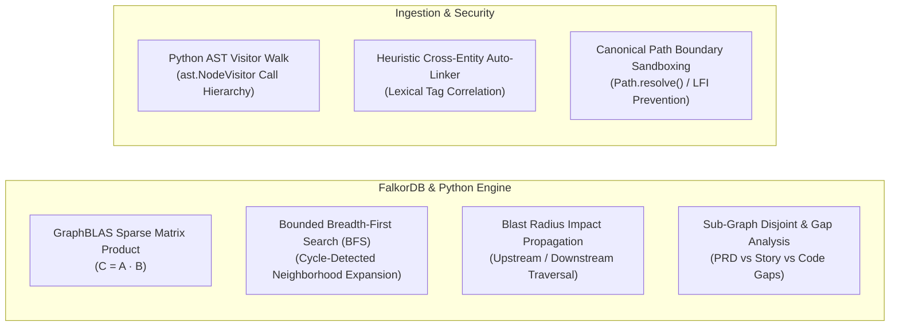

# 📐 Cypher Queries and Graph Algorithms

> **CodeGraph Technical Reference Manual**  
> **Target Graph Engine**: FalkorDB (SuiteSparse:GraphBLAS) with Deterministic In-Memory Fallback  
> **Track**: Hackathon Track 01 — Agents That Act on Connected Data  

---

## 1. Executive Summary & Graph Architecture

CodeGraph represents the complete software engineering lifecycle across a **5-Pillar Connected Knowledge Graph** anchored by `Project`:
1. **CodeBase Pillar**: Abstract Syntax Tree (AST) code hierarchy (Input $\to$ LogicFlow $\to$ Classes $\to$ Functions $\to$ CodeLogic $\to$ Output).
2. **PRD Pillar**: Product Requirements Document hierarchy (Input $\to$ FunctionalRequirements $\to$ Guardrails $\to$ Output).
3. **ADR Pillar**: Architectural Decision Records (Requirement $\to$ Architecture $\to$ Decisions $\to$ Result).
4. **Operations Pillar**: Quality history (Issues $\to$ RCA $\to$ Fixes $\to$ Operational Results).
5. **Program Flow Pillar**: Agile delivery execution (Epics $\to$ AgileFeatures $\to$ Stories $\to$ Code/Developers).
6. **Timeline & Lineage**: Change history capturing **WHAT** was modified and **WHY** it was changed.

All relationships are modeled as directed, attributed property edges evaluated using **GraphBLAS sparse adjacency matrix linear algebra** over semirings.

---

## 2. Graph Algorithms Implemented



### 1. GraphBLAS Sparse Matrix-Matrix Multiplication ($C = A \cdot B$)
- **Component**: FalkorDB Database Layer ([`codegraph/db.py`](file:///Users/ashwin/Documents/Projects/GraphHack/codegraph/db.py)).
- **Algorithm Description**: Instead of traditional pointer-chasing joins, relationships are stored as boolean sparse matrices. Multi-hop path evaluations (such as `(Requirement)-[:IMPLEMENTED_BY_FUNCTION]->(Function)<-[:CONSTRAINS_FUNCTION]-(Decision)`) execute as high-performance linear algebraic matrix-matrix multiplications over semirings:
  $$C_{i, j} = \bigvee_k \left( A_{i, k} \wedge B_{k, j} \right)$$
- **Complexity**: Optimized by SuiteSparse:GraphBLAS to scale with the number of non-zero entries (NNZ) rather than total node count, achieving sub-millisecond multi-hop execution.

---

### 2. Bounded Breadth-First Search (BFS) with Cycle Avoidance
- **Component**: [`LocalMemoryGraph.get_neighbors()`](file:///Users/ashwin/Documents/Projects/GraphHack/codegraph/db.py#L72-L95) and [`get_related_entities()`](file:///Users/ashwin/Documents/Projects/GraphHack/codegraph/tools/shared_tools.py#L60-L85).
- **Algorithm Description**: 
  - Expands an $N$-hop neighborhood ($1 \le N \le 5$) starting from any arbitrary node.
  - Maintains a FIFO traversal queue and a `visited: Set[str]` tracking visited node identifiers to avoid infinite loops on circular call graphs or recursive requirement dependencies.
  - Returns both node metadata and typed directed edges with relationship properties.

---

### 3. Blast Radius Impact Propagation & Risk Scoring
- **Component**: [`check_safe_to_change()`](file:///Users/ashwin/Documents/Projects/GraphHack/codegraph/tools/developer_tools.py#L133-L225).
- **Algorithm Description**: Evaluates the systemic blast radius of modifying a specific function before any code changes are made:
  1. **Ascent to Architecture**: Traverses incoming `CONSTRAINS_FUNCTION` edges to identify governing Architecture Decision Records (ADRs).
  2. **Traverse Incident History**: Traverses incoming `MANIFESTED_IN_FUNCTION` edges to identify past production incidents (`Issue`), Root Cause Analyses (`RCA`), and previous regression bugfixes.
  3. **Traverse Business Scope**: Traverses incoming `IMPLEMENTED_BY_FUNCTION` edges to determine which PRD functional requirements depend on the target function.
  4. **Compound Risk Calculation**:
     $$\text{Risk Score} = 3 \cdot |\text{Governing Decisions}| + 3 \cdot |\text{Historical RCAs}| + 1 \cdot |\text{PRD Requirements}|$$
     - $\text{Risk Score} \ge 6$: Classified as **`HIGH_RISK / STRICT_CONSTRAINTS`**.
     - $1 \le \text{Risk Score} < 6$: Classified as **`MEDIUM_RISK`**.
     - $\text{Risk Score} = 0$: Classified as **`SAFE_TO_CHANGE`**.

---

### 4. Disconnected Subgraph Detection & Delivery Gap Diagnosis
- **Component**: [`diagnose_execution_bottlenecks()`](file:///Users/ashwin/Documents/Projects/GraphHack/codegraph/tools/program_tools.py#L160-L345).
- **Algorithm Description**: Diagnoses the communication and execution breakdown between Product Specifications, Agile Tracking, and Engineering Code via disjoint graph analysis:
  - **Definition Gaps**: Disjoint set of PRD Requirements with zero outgoing `REALIZES_REQUIREMENT` edges to Jira Features or zero `IMPLEMENTED_BY_FUNCTION` edges:
    $$\text{DefinitionGaps} = \{ r \in \text{Requirements} \mid \text{deg}^-(r, \text{AgileFeature}) = 0 \lor \text{deg}^+(r, \text{Function}) = 0 \}$$
  - **Active Blockers**: Stories with status `BLOCKED` linked to assignees, extracting blocker causes and affected parent requirements.
  - **Ghost Deliveries**: Stories marked `DONE` in Jira with zero `IMPLEMENTS_CODE` edges pointing to real AST functions in the repository.

---

### 5. Cross-Team Capability & Synergy Mining
- **Component**: [`unlock_cross_team_capabilities()`](file:///Users/ashwin/Documents/Projects/GraphHack/codegraph/tools/program_tools.py#L820-L960).
- **Algorithm Description**: Formulates a bipartite graph between service domains (e.g. `fraud_detector`, `payment_service`, `refund_processor`) and architectural capabilities (e.g. exponential backoff pipelines, Redis idempotency locks). Detects unassigned or blocked tickets that share technical requirements with existing services, outputting pair-programming opportunities that eliminate duplicate engineering.

---

### 6. Python AST Visitor & Deterministic Call Graph Walk
- **Component**: [`CodebaseParser`](file:///Users/ashwin/Documents/Projects/GraphHack/codegraph/ingest/code_parser.py).
- **Algorithm Description**: Uses Python's standard `ast` library to parse source files into Abstract Syntax Trees. Subclasses `ast.NodeVisitor` to perform deterministic recursive walks:
  - Discovers top-level classes (`ast.ClassDef`) and functions (`ast.FunctionDef`).
  - Extracts line ranges, docstring comments, function arguments, and return annotations.
  - Identifies call expressions (`ast.Call`) to construct the directed code invocation graph (`CALLS_FUNCTION`).

---

### 7. Heuristic Cross-Entity Auto-Linker
- **Component**: [`IngestionPipeline._auto_link_cross_entities()`](file:///Users/ashwin/Documents/Projects/GraphHack/codegraph/ingest/pipeline.py#L199-L295).
- **Algorithm Description**: 
  - Builds inverted lookup maps of requirement IDs, ADR numbers, and bug tickets.
  - Scans docstrings, comments, and git commit summaries using token regular expressions (`REQ-[0-9]+`, `ADR-[0-9]+`, `BUG-[0-9]+`).
  - Synthesizes cross-pillar relationships (`IMPLEMENTED_BY_FUNCTION`, `CONSTRAINS_FUNCTION`, `MOTIVATED_BY_PRD`) during ingestion.

---

### 8. Canonical Path Sandboxing & LFI Prevention
- **Component**: [`validate_safe_path()`](file:///Users/ashwin/Documents/Projects/GraphHack/codegraph/guardrails.py#L66-L120).
- **Algorithm Description**: Canonicalizes input paths using `pathlib.Path.resolve()`, stripping relative traversal tokens (`../`) and symlink escapes. Asserts workspace containment:
  $$\text{target\_path}.\text{resolve}().\text{is\_relative\_to}(\text{settings.base\_dir})$$
  Rejects paths targeting `.env`, SSH keys, password files, or binary executables.

---

## 3. The Cypher Queries Catalog

All queries are executed with **explicit node labels** to restrict lookups to targeted GraphBLAS matrices and use **runtime parameters** (`$param`) for query plan caching.

### 1. Database Schema & Indexing Queries

#### A. Core Single-Property Indexes (Executed on Initialization)
```cypher
CREATE INDEX FOR (n:Project) ON (n.id);
CREATE INDEX FOR (n:Function) ON (n.id);
CREATE INDEX FOR (n:Function) ON (n.name);
CREATE INDEX FOR (n:Class) ON (n.id);
CREATE INDEX FOR (n:FunctionalRequirement) ON (n.id);
CREATE INDEX FOR (n:Decision) ON (n.id);
CREATE INDEX FOR (n:Issue) ON (n.id);
CREATE INDEX FOR (n:Fix) ON (n.id);
CREATE INDEX FOR (n:Epic) ON (n.id);
CREATE INDEX FOR (n:AgileFeature) ON (n.key);
CREATE INDEX FOR (n:Story) ON (n.key);
```

#### B. Lean Node Upsert with Native String Interning
```cypher
MERGE (n:Story {id: $id})
SET n += $props,
    n.status = intern($status),
    n.priority = intern($priority)
```

#### C. Explicitly-Labeled Sparse Matrix Edge Creation
```cypher
MATCH (a:Function {id: $from_id}), (b:CodeLogic {id: $to_id})
MERGE (a)-[r:EXECUTES_LOGIC]->(b)
SET r += $props
```

---

### 2. Product Manager Queries

#### A. PRD Requirement & Edge-Case Coverage
```cypher
MATCH (p:Project {id: $project_id})-[:HAS_PRD_INPUT]->(pi:PRDInput)-[:SPECIFIES_REQUIREMENT]->(r:FunctionalRequirement)
OPTIONAL MATCH (r)-[:IMPLEMENTED_BY_FUNCTION]->(f:Function)-[:EXECUTES_LOGIC]->(cl:CodeLogic)
OPTIONAL MATCH (r)-[:ENFORCES_GUARDRAIL]->(g:Guardrail)
RETURN r.id AS requirement_id,
       r.title AS title,
       r.status AS status,
       collect(DISTINCT f.name) AS implementing_functions,
       collect(DISTINCT g.rule) AS guardrails
```

#### B. Historical Change Motivation Audit
```cypher
MATCH (p:Project {id: $project_id})-[:HAS_TIMELINE_RECORD]->(tl:ChangeTimeline)
OPTIONAL MATCH (tl)-[:MOTIVATED_BY_PRD]->(r:FunctionalRequirement)
OPTIONAL MATCH (tl)-[:MOTIVATED_BY_ADR]->(d:Decision)
OPTIONAL MATCH (tl)-[:MOTIVATED_BY_FIX]->(fx:Fix)
OPTIONAL MATCH (tl)-[:CHANGED_NODE]->(cl:CodeLogic)
RETURN tl.event_date AS date,
       tl.title AS change_title,
       tl.reason AS business_reason,
       r.title AS requirement,
       d.title AS architecture_decision
ORDER BY tl.event_date DESC
```

---

### 3. Developer Persona Queries

#### A. Production Incident Root Cause Analysis (RCA)
```cypher
MATCH (i:Issue {id: $issue_id})-[:ANALYZED_BY_RCA]->(rca:RCA)-[:RESOLVED_BY_FIX]->(fx:Fix)-[:ACHIEVES_RESULT]->(res:OpResult)
OPTIONAL MATCH (i)-[:MANIFESTED_IN_FUNCTION]->(f:Function)-[:EXECUTES_LOGIC]->(cl:CodeLogic)
OPTIONAL MATCH (i)-[:VIOLATED_DECISION]->(d:Decision)
RETURN i.title AS symptom,
       rca.root_cause_category AS root_cause_category,
       rca.description AS root_cause,
       fx.action_taken AS fix_action,
       f.name AS bug_location,
       d.id AS violated_adr
```

#### B. Safe-to-Change Blast Radius Analysis
```cypher
MATCH (f:Function {name: $function_name})
OPTIONAL MATCH (dec:Decision)-[:CONSTRAINS_FUNCTION]->(f)
OPTIONAL MATCH (f)<-[:MANIFESTED_IN_FUNCTION]-(iss:Issue)-[:ANALYZED_BY_RCA]->(rca:RCA)
OPTIONAL MATCH (r:FunctionalRequirement)-[:IMPLEMENTED_BY_FUNCTION]->(f)
OPTIONAL MATCH (f)-[:EXECUTES_LOGIC]->(cl:CodeLogic)
RETURN f.name AS function_name,
       collect(DISTINCT dec.title) AS architectural_constraints,
       collect(DISTINCT rca.root_cause_category) AS past_root_causes,
       collect(DISTINCT r.id) AS dependent_requirements
```

#### C. Cross-Organization Bug Pattern Check
```cypher
MATCH (i:Issue)-[:ANALYZED_BY_RCA]->(rca:RCA)-[:RESOLVED_BY_FIX]->(fx:Fix)
OPTIONAL MATCH (i)-[:MANIFESTED_IN_FUNCTION]->(f:Function)
WHERE rca.root_cause_category CONTAINS $keyword
   OR i.title CONTAINS $keyword
   OR fx.action_taken CONTAINS $keyword
RETURN i.id AS issue_id,
       i.title AS title,
       rca.root_cause_category AS category,
       fx.action_taken AS fix,
       f.name AS function_name
```

---

### 4. Technical Program Manager (TPM) Queries

#### A. Agile Delivery Status & Burndown Aggregation
```cypher
MATCH (p:Project {id: $project_id})-[:HAS_EPIC]->(e:Epic)
OPTIONAL MATCH (e)-[:HAS_FEATURE]->(f:AgileFeature)
OPTIONAL MATCH (f)-[:HAS_STORY]->(s:Story)
RETURN e.key AS epic_key,
       e.summary AS epic_name,
       collect(DISTINCT f) AS features,
       collect(DISTINCT s) AS stories,
       sum(s.story_points) AS total_story_points
```

#### B. Cross-Pillar Execution Bottleneck Diagnosis
```cypher
MATCH (p:Project {id: $project_id})-[:HAS_PRD_INPUT]->(pi:PRDInput)-[:SPECIFIES_REQUIREMENT]->(r:FunctionalRequirement)
OPTIONAL MATCH (f:AgileFeature)-[:REALIZES_REQUIREMENT]->(r)
OPTIONAL MATCH (f)-[:HAS_STORY]->(s:Story)
OPTIONAL MATCH (r)-[:IMPLEMENTED_BY_FUNCTION]->(fn:Function)
RETURN r.id AS req_id,
       r.title AS req_title,
       f.key AS feature_key,
       count(s) AS story_count,
       fn.name AS implementing_code
```

#### C. 5-Pillar End-to-End Traceability Chain
```cypher
MATCH (p:Project {id: $project_id})-[:HAS_EPIC]->(e:Epic)-[:HAS_FEATURE]->(f:AgileFeature)
OPTIONAL MATCH (f)-[:HAS_STORY]->(s:Story)
OPTIONAL MATCH (s)-[:IMPLEMENTS_CODE]->(fn:Function)
OPTIONAL MATCH (fn)-[:EXECUTES_LOGIC]->(cl:CodeLogic)
OPTIONAL MATCH (s)-[:GUIDED_BY_ARCHITECTURE]->(d:Decision)
RETURN e.key AS epic, f.key AS feature, s.key AS story, fn.name AS code, d.id AS adr
```

---

### 5. Shared Discovery Queries

#### A. Full-Text Search over Core Matrices
```cypher
MATCH (n)
WHERE any(lbl IN labels(n) WHERE lbl IN ['Project', 'Function', 'FunctionalRequirement', 'Decision', 'Issue', 'Epic', 'AgileFeature', 'Story'])
  AND any(prop IN keys(n) WHERE toString(n[prop]) CONTAINS $query)
RETURN n LIMIT $limit
```

#### B. Bounded N-Hop Neighborhood Expansion
```cypher
MATCH path = (start:Function {id: $node_id})-[*1..3]-(connected)
RETURN path
```
