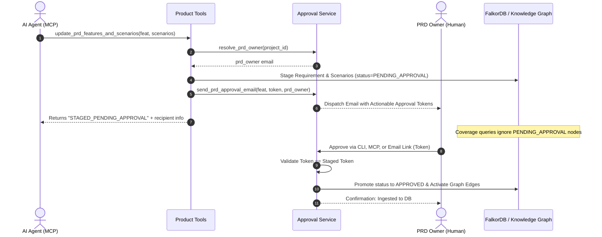

# ADR-013: PRD Agent Updates and PRD Owner Email Approval Workflow

**ADR ID:** `ADR-013`  
**Title:** PRD Agent Updates and PRD Owner Email Approval Workflow  
**Status:** `ACCEPTED`  
**Date:** `2026-10-18`  
**Author:** CodeGraph Architecture Working Group  
**Component:** `codegraph/schema.py`, `codegraph/approval_service.py`, `codegraph/tools/product_tools.py`, `codegraph/mcp_server.py`, `codegraph/__main__.py`

---

## Context
Autonomous AI agents (such as Product Advisors, specification generators, or backlog refinement assistants) can dynamically propose new features, user stories, acceptance scenarios (Given/When/Then), and operational guardrails based on stakeholder chats, customer feedback, or missing implementation gaps.

Directly writing these agent-suggested product requirements directly into the active knowledge graph without governance introduces critical operational and architectural risks:
1. **Metric Distortion & Premature Deficit Alerts:** Unapproved feature proposals immediately inflate `query_prd_coverage()` and `list_uncovered_requirements()`, reporting false compliance and coverage deficits to engineering teams before product leadership has committed to the scope.
2. **Uncontrolled Scope Creep:** Hallucinated or speculative agent requirements could misdirect test generation, PR reviews, and sprint planning.
3. **Discipline Sovereignty:** Just as code fixes require signoff from the Code Domain Owner ([ADR-011](011-domain-owner-email-approval-and-ingestion-flow.md)), functional specifications, compliance guardrails, and acceptance test scenarios must strictly require signoff from the **PRD Owner** registered on the root `Project` node ([ADR-012](012-project-entity-dual-ownership-model.md)).

The requirement mandates: *The PRD document can be updated with scenarios and new features via the agent, but the approval will go to the PRD owner of that project via email. Once approved, it should be ingested into the DB.*

---

## Decision

We establish an end-to-end staged agent update, PRD Owner email dispatch, and token-verified database ingestion workflow:

1. **Schema Enhancements for Staged Approval (`codegraph/schema.py`):**
   - **`FunctionalRequirementNode`**:
     - `status: str = "PENDING_APPROVAL"` (allowed values: `PENDING_APPROVAL`, `APPROVED`, `IMPLEMENTED`).
     - `approval_token: Optional[str] = None`: Cryptographically generated 16-byte token (`secrets.token_hex(16)`).
     - `prd_owner_email: Optional[str] = None`: Targeted recipient email resolved from the project.
     - `approved_by: Optional[str] = None`: Audited email of the confirming product lead.
   - **`ScenarioNode`**:
     - `status: str = "APPROVED"` (or `PENDING_APPROVAL` while staged with a new feature).

2. **Project PRD Owner Resolution (`codegraph/approval_service.py`):**
   - The `resolve_prd_owner(project_id)` function queries the active graph for `(:Project {project_id})` and extracts its `prd_owner` attribute.
   - Falls back gracefully to `codegraph.config.PRD_OWNER` if the project node is not yet populated.

3. **Agent PRD Update Tool (`codegraph/tools/product_tools.py`):**
   - The `update_prd_features_and_scenarios(...)` tool allows agents to submit new features, descriptions, priorities, acceptance scenarios, and guardrails.
   - Unless explicitly pre-approved (`approved_by_prd_owner=True`), the tool:
     - Generates a fresh cryptographic token.
     - Stages the `FunctionalRequirementNode` and attached `ScenarioNode` instances in the database with status `PENDING_APPROVAL`.
     - Formats and dispatches an actionable approval email to the project's PRD Owner via standard library `smtplib` (`send_prd_approval_email`).
     - Records the email in `.codegraph_email_outbox.json` and in-memory outbox for zero-dependency testing.

4. **Active Metric & Invariant Isolation:**
   - Both `query_prd_coverage()` and `list_uncovered_requirements()` explicitly filter out any requirement with `status == "PENDING_APPROVAL"`.
   - Staged agent proposals cannot distort coverage percentages or trigger spurious developer alerts until formally approved.

5. **Token-Verified Ingestion & Edge Activation (`approve_prd_update_and_ingest`):**
   - When the PRD Owner approves (via CLI `codegraph approve-prd`, MCP tool `approve_prd_update_via_email`, or HTTP webhook):
     - Validates the provided token against `stored_token`.
     - Promotes `status` to `APPROVED` on both the feature requirement and its scenario nodes.
     - Sets `approved_by` to the PRD Owner's email.
     - Activates the `(:Project)-[:SPECIFIES_REQUIREMENT]->(:FunctionalRequirement)` and `(:FunctionalRequirement)-[:HAS_SCENARIO]->(:Scenario)` edges in FalkorDB.
     - Flushes state to persistent backend storage.

6. **Symmetrical Multi-Channel Interface:**
   - **CLI:** `uv run python -m codegraph approve-prd --feature-id <id> --token <token> --approver <email>`
   - **MCP Tool:** `approve_prd_update_via_email(feature_id=..., approval_token=..., approver_email=...)`
   - **Email One-Click Action:** Encoded approval URLs for enterprise mail client interaction.

---

## Architecture Flow

---

## Consequences

### Positive Impact
- **Discipline Sovereignty:** Product leadership maintains complete control over feature scope, guardrails, and acceptance test definitions.
- **Metric Integrity:** Active coverage calculations remain unpolluted by tentative or exploratory agent ideation.
- **Zero-Dependency Email Ingestion:** Full email formatting, token generation, and audit trail operation with Python standard library (`smtplib`, `secrets`, `email`).
- **Symmetric Architecture:** Complements ADR-011 (Code Domain Owner approval for engineering fixes) with ADR-013 (PRD Owner approval for product requirements).

### Tradeoffs
- Agent updates require an asynchronous human approval step before becoming active in downstream PR review checks.

---

## Architectural Invariants
1. `PRD_APPROVAL_ISOLATION`: Staged requirements with `status == "PENDING_APPROVAL"` must never appear as active missing requirements in `query_prd_coverage()` or `list_uncovered_requirements()`.
2. `CRYPTOGRAPHIC_PRD_TOKEN_MATCH`: Feature activation requires an exact match with the staged `approval_token`.
3. `PRD_APPROVAL_IDEMPOTENCY`: Re-approving an already active requirement returns status `ALREADY_APPROVED` without duplicating scenario nodes or edges.
