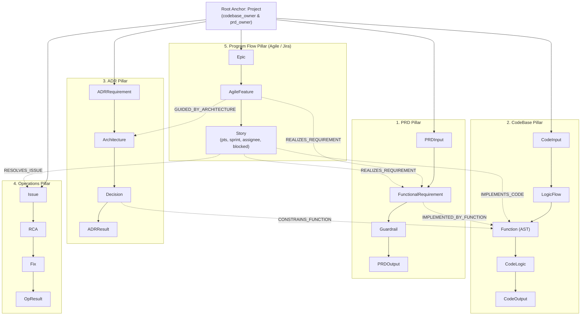

# ADR-014: Program Manager Persona and Agile Execution Flow (5th Pillar & Jira Ingestion)

**ADR ID:** `ADR-014`  
**Title:** Program Manager Persona and Agile Execution Flow (5th Pillar & Jira Ingestion)  
**Status:** `ACCEPTED`  
**Date:** `2026-10-18`  
**Author:** CodeGraph Architecture Working Group  
**Component:** `codegraph/schema.py`, `codegraph/tools/program_tools.py`, `codegraph/ingest/jira_parser.py`, `codegraph/mcp_server.py`, `prompts/program-persona.md`

---

## Context
In modern software organizations, Technical Program Managers (TPMs), Agile Delivery Leads, and Scrum Masters face critical friction when overseeing product delivery:
1. **The PRD-to-Code Visibility Gap:** Tracking whether product requirements (PRDs) have actually been converted into verified repository code requires constant status sync meetings between engineering and product.
2. **Invisible Bottlenecks:** When a feature delivery slips, TPMs cannot easily diagnose where the breakdown occurred: Is it stalled in product definition, delayed in architectural consensus (ADR), blocked on an external dependency (Jira story blocker), or lagging in code implementation / PR reviews?
3. **Ghost Deliveries (False Progress):** Jira tickets marked "Done" often provide a false sense of security while the underlying AST code functions, integration tests, or compliance guardrails were never actually merged.
4. **Lead Time Blindness:** There is no unified, grounded method to measure the actual lead time from PRD requirement conception $\to$ architectural decision $\to$ sprint story allocation $\to$ verified code commit $\to$ operational stability.

The requirement mandates: *The program managers should have an agent which fetches progress and gaps from grounded data. There should be a separate Program Flow following agile methodology (Epics, Features, Stories) integrated with Jira board data and linked with PRD, ADR, CodeBase, and Operations.*

---

## Decision

We establish the **5th Pillar: Program Flow** and introduce a dedicated **Program Manager Persona & Agent Tools**:

1. **The 5th Pillar: Program Flow Data Model (`codegraph/schema.py`):**
   We extend the core property graph schema anchored by `Project`:
   - **`EpicNode` (`Project` $\to$ `Epic`):** Project-level strategic initiatives (e.g., `PAY-EPIC-101: Core Card Checkout & Authorization Engine`).
   - **`AgileFeatureNode` (`Epic` $\to$ `AgileFeature`):** Functional domain / service-level separation (e.g., `PAY-FEAT-201: Card Payment Pre-Validation & Ingestion`), linking to microservices, architecture diagrams, and `FunctionalRequirement` nodes.
   - **`StoryNode` (`AgileFeature` $\to$ `Story`):** Task-level developer execution units assigned to engineers, tracking story points, sprint, status (`TODO`, `IN_PROGRESS`, `IN_REVIEW`, `DONE`), created/resolved dates, cycle time in calendar days, and blocker flags/reasons.

2. **Cross-Pillar Typed Relationships (`Relationships`):**
   - `HAS_EPIC`: `(Project) -> (Epic)`
   - `HAS_FEATURE`: `(Epic) -> (AgileFeature)`
   - `HAS_STORY`: `(AgileFeature) -> (Story)`
   - `REALIZES_REQUIREMENT`: `(AgileFeature | Story) -> (FunctionalRequirement)` (PRD)
   - `GUIDED_BY_ARCHITECTURE`: `(AgileFeature | Story) -> (Architecture | Decision)` (ADR)
   - `IMPLEMENTS_CODE`: `(Story) -> (Function)` (CodeBase AST)
   - `ASSIGNED_TO_DEVELOPER`: `(Story) -> (Developer / Code Domain Owner)`
   - `RESOLVES_ISSUE`: `(Story) -> (Issue)` (Operations)

3. **Jira Board Ingestion Pipeline (`codegraph/ingest/jira_parser.py`):**
   - Zero-dependency parser that handles both structured Jira exports and standard Jira Cloud/Server REST API search responses (`{"issues": [...]}`).
   - Automatically maps parent-child hierarchies, extracts story points, sprint allocations, and cycle times, detects blocker flags/reasons, and resolves text cross-references (`REQ-xxx`, `ADR-xxx`, `BUG-xxx`).
   - Integrated into `IngestionPipeline.run(..., jira_file=...)` and CLI `codegraph ingest --jira <file>`.

4. **Program Manager Persona Tools (`codegraph/tools/program_tools.py`):**
   We implement 5 dedicated MCP tools for delivery intelligence:
   - **`query_program_delivery_status`**: Computes overall delivery progress percentage, committed vs completed story points, sprint health, and active blockers across Epics, Features, and Stories.
   - **`diagnose_delivery_bottlenecks`**: Pinpoints root-cause delivery friction across 4 categories:
     1. *Definition & Backlog Gaps:* PRD requirements with zero or uncommitted Jira stories.
     2. *Active Blockers:* Stories marked blocked, surfacing developer assignees and blocker rationales.
     3. *Ghost Deliveries:* Tickets marked "Done" in Jira with zero implementing AST functions in the repository.
     4. *Healthy Deliveries:* End-to-end verified features.
   - **`get_feature_lead_time_metrics`**: Calculates average cycle times and highlights fast-turnaround vs high-latency deliverables.
   - **`trace_requirement_to_delivery_chain`**: Multi-hop 5-pillar traceability across PRD $\longleftrightarrow$ Jira $\longleftrightarrow$ ADR $\longleftrightarrow$ Code $\longleftrightarrow$ Operations.
   - **`ingest_jira_board`**: Live ingestion of external Jira board exports.

5. **Tri-Persona Multi-Agent Architecture (`prompts/program-persona.md`):**
   - **Product Advisor (`prompts/product-persona.md`):** Plain English, PRD coverage %, zero code syntax.
   - **Developer Assistant (`prompts/developer-persona.md`):** Technical diagnostics, line numbers, ADR constraints, regression safety.
   - **Program Advisor (`prompts/program-persona.md`):** Agile delivery velocity, sprint burndown, cycle time, blocked dependencies, PRD-to-code gap diagnosis.

---

## Architecture Flow

---

## Consequences

### Positive Impact
- **No More Status Sync Overhead:** Program Managers query grounded graph data instead of setting up recurring sync meetings.
- **Root-Cause Bottleneck Discovery:** Immediately identifies whether delays stem from product backlog inertia, architectural indecision, or active engineering blockers.
- **Ghost Delivery Prevention:** Eliminates false confidence by cross-verifying Jira "Done" tickets against AST repository code.
- **Unified 5-Pillar Traceability:** Completes the corporate institutional knowledge model across Product, Program, Architecture, Engineering, and Operations.

### Tradeoffs
- Requires regular ingestion of Jira board exports or CI/CD webhook syncs to keep agile sprint metrics fresh.

---

## Architectural Invariants
1. `AGILE_GRAPH_GROUNDING`: All delivery velocity, cycle time, and blocker metrics must be computed from active graph nodes and relationships (never hallucinated).
2. `GHOST_DELIVERY_DETECTION`: A requirement is only classified as healthy if both Jira status and AST repository implementation match.
3. `PROGRAM_PERSONA_JARGON_FREE`: Responses from the Program Advisor must focus on delivery metrics, velocity, and blockers, avoiding raw AST source code snippets.
