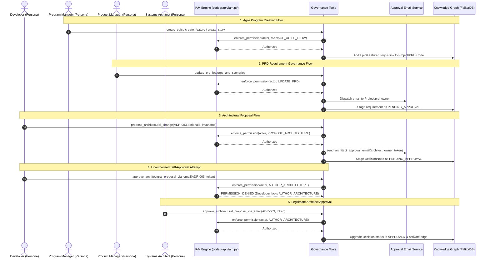

# ADR-016: Role-Based Access Control (RBAC) and Architectural Governance

**ADR ID:** `ADR-016`  
**Title:** Role-Based Access Control (RBAC) and Architectural Governance  
**Status:** `ACCEPTED`  
**Date:** `2026-10-18`  
**Author:** CodeGraph Architecture Working Group  
**Component:** `codegraph/iam.py`, `codegraph/tools/architect_tools.py`, `codegraph/tools/program_tools.py`, `codegraph/tools/product_tools.py`, `codegraph/tools/ingest_tools.py`, `codegraph/approval_service.py`, `codegraph/mcp_server.py`

---

## Context

As CodeGraph expanded to support a **5-Pillar Connected Knowledge Graph** serving Product Managers, Technical Program Managers (TPMs), Software Developers, and Systems Architects, autonomous multi-agent mutations introduced critical governance challenges:

1. **Role Boundary Violations:** Without identity and permission boundaries, any agent persona could execute unauthorized domain mutations (e.g. an engineering agent silently redefining business acceptance criteria in a PRD, or a product agent modifying Python source files).
2. **Program Flow Creation Needs:** Program Managers require direct agent capabilities to instantiate new Epics, Features, and developer task Stories in the Program Flow, yet this authority must be restricted exclusively to program delivery leads.
3. **Architectural Drift vs. Developer Proposals:** In high-velocity teams, developers frequently propose architectural adjustments (e.g. altering retry intervals, modifying connection pools, introducing new sharding strategies). If developers can unilaterally commit ADRs, system resilience invariants are broken; conversely, if developers cannot propose architectural improvements, knowledge graph architecture rots into a stagnant artifact.
4. **Separation of Duties:** Industry security standards (SOC 2, ISO 27001) mandate that individuals proposing a system modification cannot be the sole approvers of that modification, and distinct functional domains must possess designated accountable owners.

---

## Decision

We establish an enterprise **Identity and Access Management (IAM) and Role-Based Access Control (RBAC)** architecture alongside an **Architectural Governance Workflow**:

### 1. IAM Permission Matrix & Enforcement Engine (`codegraph/iam.py`)

We define discrete roles and granular permissions:

- **Roles:**
  - `PROGRAM_MANAGER`: Delivery leads and TPMs managing agile execution.
  - `PRODUCT_MANAGER`: Product managers and business stakeholders defining requirements and scenarios.
  - `DEVELOPER`: Software engineers developing code, triage incidents, and proposing architectural changes.
  - `ARCHITECT`: Lead systems architects governing ADR patterns, system invariants, and approving proposals.
  - `ADMIN`: Platform administrators with unrestricted access.

- **Granular Permissions:**
  - `MANAGE_AGILE_FLOW`: Create and manage Epics, Features, and Stories.
  - `UPDATE_PRD`: Propose and update PRD requirements, acceptance scenarios, and guardrails.
  - `MODIFY_CODEBASE`: Stage and commit bugfixes, code logic, and AST mutations.
  - `PROPOSE_ARCHITECTURE`: Submit architectural changes and ADR proposals for review.
  - `AUTHOR_ARCHITECTURE`: Directly author or approve architectural ADR decisions and enforce invariants.
  - `READ_GRAPH`: Query knowledge graph data, delivery diagnostics, and metric aggregations.

| Role | `MANAGE_AGILE_FLOW` | `UPDATE_PRD` | `MODIFY_CODEBASE` | `PROPOSE_ARCHITECTURE` | `AUTHOR_ARCHITECTURE` | `READ_GRAPH` |
|---|:---:|:---:|:---:|:---:|:---:|:---:|
| **PROGRAM_MANAGER** | ✅ | ❌ | ❌ | ❌ | ❌ | ✅ |
| **PRODUCT_MANAGER** | ❌ | ✅ | ❌ | ❌ | ❌ | ✅ |
| **DEVELOPER**       | ❌ | ❌ | ✅ | ✅ | ❌ | ✅ |
| **ARCHITECT**       | ❌ | ❌ | ❌ | ✅ | ✅ | ✅ |
| **ADMIN**           | ✅ | ✅ | ✅ | ✅ | ✅ | ✅ |

### 2. Program Manager Agent Creation Tools (`codegraph/tools/program_tools.py`)

Program Managers can create and link Agile hierarchy entities directly through their agent:
- `create_epic(epic_key, summary, description, project_id, owner, target_date)`: Instantiates `EpicNode` and links `(Project)-[:HAS_EPIC]->(Epic)`.
- `create_feature(feature_key, epic_key_or_id, summary, description, service_name, req_id)`: Instantiates `AgileFeatureNode` under an Epic and links to PRD requirements via `REALIZES_REQUIREMENT`.
- `create_story(story_key, feature_key_or_id, summary, story_points, assignee, sprint, func_id)`: Instantiates `StoryNode` under a Feature and connects to implementing code functions via `IMPLEMENTS_CODE`.

All three operations enforce `Permission.MANAGE_AGILE_FLOW`. Unauthorized personas receive structured `PERMISSION_DENIED` errors.

### 3. Developer Architectural Proposal & Architect Approval Workflow (`codegraph/tools/architect_tools.py`)

We introduce a formal dual-custody lifecycle for architectural decisions (ADRs):

1. **Developer Proposal:** A developer calls `propose_architectural_change`. IAM verifies `PROPOSE_ARCHITECTURE`.
2. **Staged Ingestion:** The decision is created in the knowledge graph with `status="PENDING_APPROVAL"`, generating a cryptographic 128-bit approval token. The relationship `(:Architecture)-[:LEADS_TO_DECISION {status: 'PENDING_APPROVAL'}]->(:Decision)` is staged.
3. **Email Dispatch to Project Architect:** An approval email is automatically dispatched to the project's designated Lead Architect (`Project.architect_owner`):
   - Outlines the pattern, decision statement, rationale, invariants, and author identity.
   - Provides a one-click email approval link, terminal CLI command, and MCP tool call.
4. **Architect Approval:** The architect executes `approve_architectural_proposal_via_email(decision_id, approval_token)`. IAM verifies `AUTHOR_ARCHITECTURE`.
   - The decision's status is upgraded to `APPROVED`.
   - The graph edge is activated.
   - Developers attempting to approve their own or peers' proposals are rejected with `PERMISSION_DENIED`.
5. **Architect Direct Authoring:** If an authorized Architect authors a decision directly with `approved_by_architect=True`, the decision is immediately committed as `APPROVED`.

### 4. Triple Project Ownership Schema (`codegraph/schema.py`)

`ProjectNode` explicitly stores three distinct domain owners:
- `codebase_owner: str` (e.g. `payment-tech-lead@payflow.internal`): Approves code fixes and AST changes.
- `prd_owner: str` (e.g. `product-lead@payflow.internal`): Approves PRD requirements and scenarios.
- `architect_owner: str` (e.g. `architect-lead@payflow.internal`): Approves architectural changes and ADR invariants.

---

## Architecture Flow

---

## Consequences

### Positive
- **Guaranteed Separation of Duties:** Eliminates unauthorized cross-domain mutations while respecting each persona's natural responsibilities.
- **Empowered Developer Agency:** Developers can freely propose architectural patterns through agent tools without risking architectural drift or unauthorized commits.
- **Auditable Architectural Lineage:** Every architectural decision records `proposed_by`, `approved_by`, `status`, and `approval_token`.
- **Zero-Friction Email Approvals:** Architects receive structured emails with one-click links, CLI instructions, and MCP tool signatures.
- **Seamless Backward Compatibility:** Optional actor parameters default to authorized domain identities, keeping all legacy test suites and commands functional.

### Invariants
1. `IAM_PERMISSION_ENFORCEMENT`: All state-mutating tools (`create_epic`, `create_feature`, `create_story`, `update_prd_features_and_scenarios`, `record_bugfix`, `propose_architectural_change`, `approve_architectural_proposal_via_email`) must pass through `iam.enforce_permission`.
2. `ARCHITECTURAL_APPROVAL_SEPARATION`: Only actors with `AUTHOR_ARCHITECTURE` permission can approve an architectural proposal.
3. `TRIPLE_PROJECT_OWNERSHIP`: Every `Project` node must maintain non-empty `codebase_owner`, `prd_owner`, and `architect_owner` attributes.
