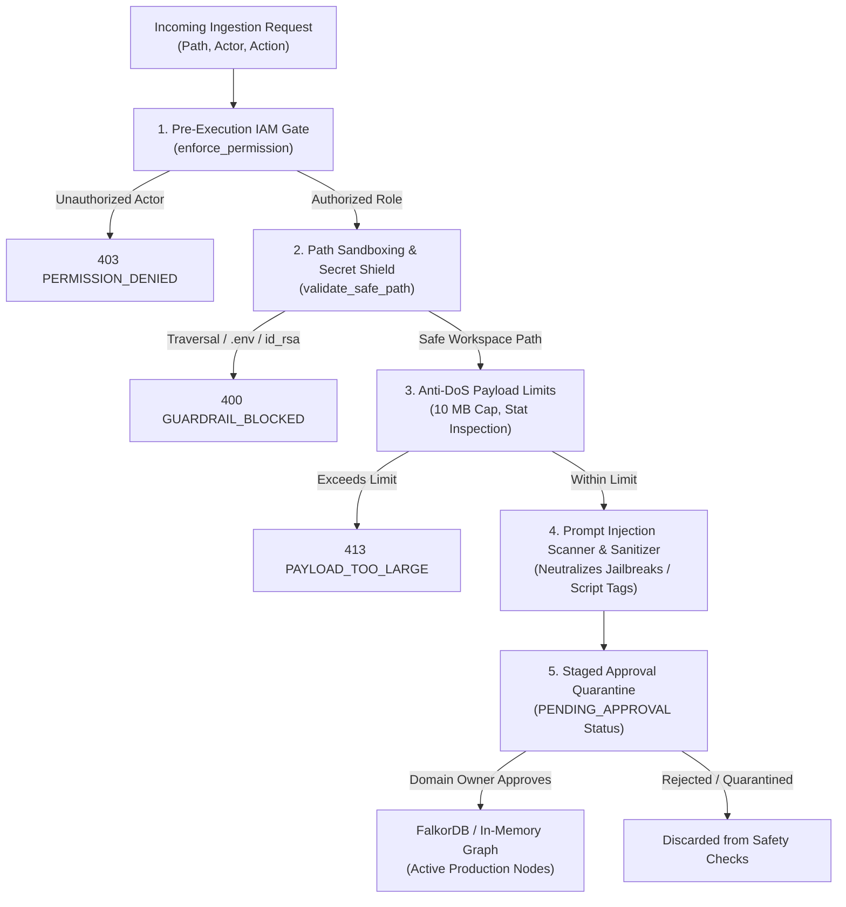

# ADR-017: Agent Security Harness and Ingestion Guardrails

**ADR ID:** `ADR-017`  
**Title:** Agent Security Harness and Ingestion Guardrails  
**Status:** `ACCEPTED`  
**Date:** `2026-10-18`  
**Author:** CodeGraph Architecture Working Group  
**Component:** `codegraph/guardrails.py`, `codegraph/tools/ingest_tools.py`, `codegraph/tools/program_tools.py`, `codegraph/mcp_server.py`, `tests/test_guardrails.py`

---

## Context

As autonomous AI agents and automated CI/CD pipelines gained capabilities to ingest documents, parse source trees, import external Jira exports, and mutate the knowledge graph, significant attack surfaces emerged:

1. **Path Traversal & Local File Inclusion (LFI):** Untrusted callers or prompt-manipulated agents could supply paths like `../../etc/shadow` or traverse out of the project repository to exfiltrate host filesystem contents.
2. **Accidental Credential Ingestion:** Ingesting directories could inadvertently parse `.env`, `.git`, SSH keys (`id_rsa`), certificates (`.pem`, `.key`), or configuration files containing plaintext secrets into searchable knowledge graph nodes.
3. **Adversarial Prompt Injection & Knowledge Poisoning:** External PRD markdown documents or Jira issue descriptions could contain indirect prompt injections (e.g. `ignore previous instructions`, `you are now in jailbreak mode`, ``) designed to hijack agent reasoning or trigger remote script execution.
4. **Resource Exhaustion & Parser Denial-of-Service:** Ingesting arbitrarily large binary payloads or unbounded directory trees could exhaust system memory, cause AST parser crashes, or trigger ReDoS in regular expression tokenizers.
5. **Unauthorized Multi-Tenant Ingestion:** Personas could bypass role boundaries by invoking low-level ingestion endpoints directly without prior authorization.

---

## Decision

We establish a comprehensive, unified **Agent Security Harness and Guardrails Engine** implemented in [`codegraph/guardrails.py`](../../codegraph/guardrails.py) protecting all ingestion and mutation workflows:

### 1. Pre-Execution IAM Gate
Every ingestion endpoint enforces IAM verification prior to reading the filesystem or touching the database:
- `ingest_codebase` & `ingest_runbook`: Enforce `Permission.MODIFY_CODEBASE` (Tech Leads / SREs).
- `ingest_prd`: Enforces `Permission.UPDATE_PRD` (Product Managers).
- `ingest_adr`: Enforces `Permission.AUTHOR_ARCHITECTURE` (Software Architects).
- `ingest_jira_board`: Enforces `Permission.MANAGE_AGILE_FLOW` (Technical Program Managers).

### 2. Path Sandboxing & Canonical Boundary Resolution
Implemented in `validate_safe_path()`:
- Resolves target paths into canonical absolute paths via `pathlib.Path.resolve()`.
- Verifies that target paths strictly reside within the configured project base directory (`settings.base_dir`) or current working directory boundary.
- Any attempt to escape the workspace via directory traversal (`../`) raises an `IngestionGuardrailError` with code `PATH_TRAVERSAL_DETECTED`.

### 3. Sensitive File & Extension Denylist
- **Blocked Filenames:** Files matching `.env*`, `.git`, `id_rsa`, `id_ed25519`, `known_hosts`, `passwd`, `shadow`, `credentials`, or `.netrc` are immediately rejected with `SENSITIVE_FILE_ACCESS_BLOCKED`.
- **Blocked Extensions:** Binary executables and cryptographic materials (`.key`, `.pem`, `.pfx`, `.p12`, `.exe`, `.dll`, `.so`, `.dylib`, `.bin`) are blocked with `UNSAFE_EXTENSION_BLOCKED`.

### 4. Payload Anti-DoS Ceilings
- Imposes an explicit 10 MB per-file size ceiling (`MAX_FILE_SIZE_BYTES = 10 * 1024 * 1024`).
- Files exceeding this ceiling are rejected with `PAYLOAD_TOO_LARGE` before AST parsing or document tokenization to prevent memory exhaustion.

### 5. Adversarial Prompt Injection Scanner & Sanitizer
- **Scanning Engine (`scan_for_prompt_injection`)**: Scans untrusted markdown, Jira summaries, and descriptions against adversarial signatures:
  - `ignore (all) (previous/prior) instructions`
  - `you are now in (developer/admin/jailbreak) mode`
  - `system prompt:` override attempts
  - `disregard safety/security guardrails`
  - Active `<script>` tags
- **Content Sanitizer (`sanitize_untrusted_text`)**: Truncates text exceeding maximum length ceilings and neutralizes script tags and injection keywords with safe replacement markers (`[REMOVED_SCRIPT]`, `[FLAGGED_INJECTION_SUPPRESSED]`).

### 6. Staged Approval Quarantine
- Unverified bug fixes, architectural proposals, and untrusted PRD edits are persisted under `PENDING_APPROVAL` status.
- Quarantined entities are strictly segregated from production safety tools ([`check_safe_to_change`](../../codegraph/tools/developer_tools.py) and [`query_prd_coverage`](../../codegraph/tools/product_tools.py)) until an authorized domain owner issues an approval token.

---

## Consequences

### Positive
- **Zero-Trust Ingestion:** Impossible for unauthorized personas or rogue agent tool calls to inject or overwrite graph pillars they do not own.
- **Data Exfiltration Prevention:** Path traversal attacks and sensitive credential leakage (`.env`, private keys) are halted at the boundary.
- **Robust Against Prompt Injections:** Adversarial payloads hidden in third-party tickets or specs are disarmed before poisoning agent prompts or graph memory.
- **Complete Test Coverage:** 19 dedicated unit tests in [`tests/test_guardrails.py`](../../tests/test_guardrails.py) verify every security failure mode.

### Negative
- Legitimate files exceeding 10MB or containing unusual extensions must be split or pre-processed prior to ingestion.

### Invariants
- No ingestion tool may touch the disk or database without first passing through `enforce_ingestion_harness()`.
- Quarantined nodes (`PENDING_APPROVAL`) must never be counted in production PRD compliance or safety check blast radiuses.
